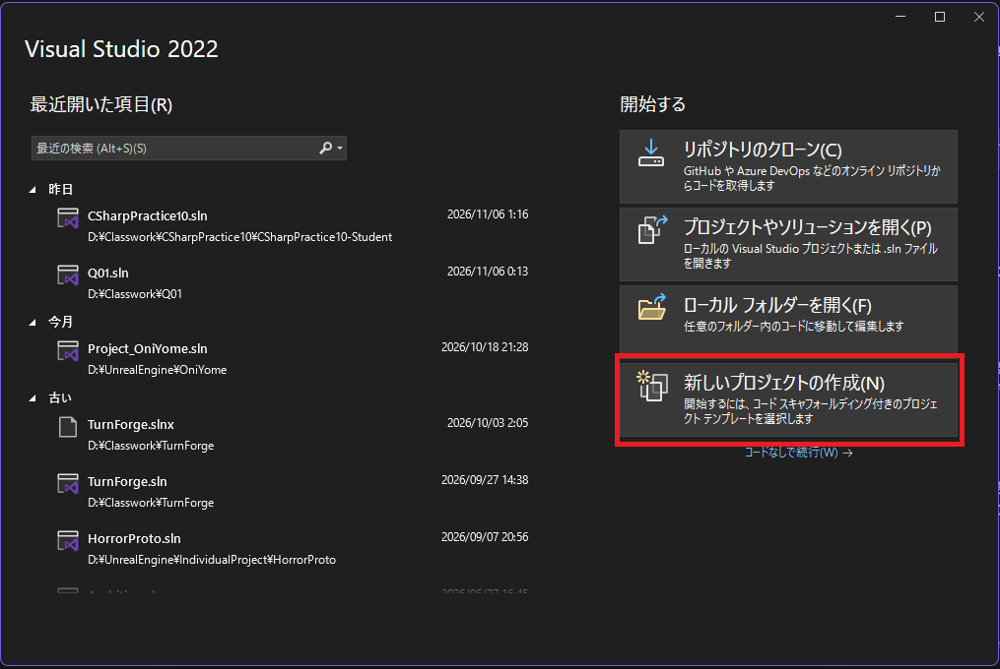
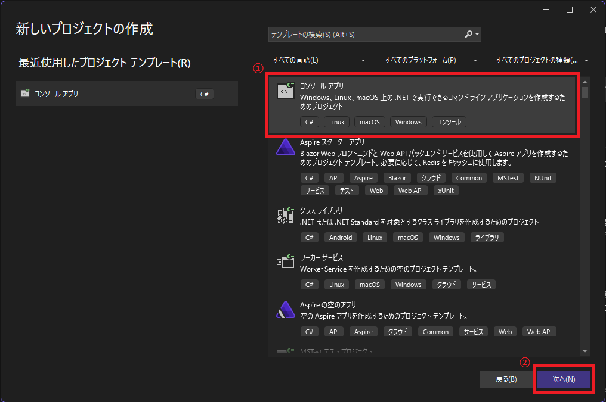
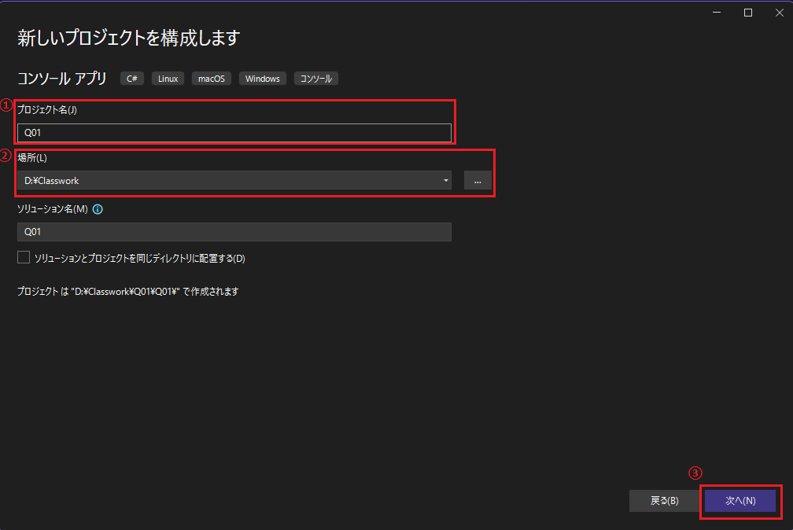
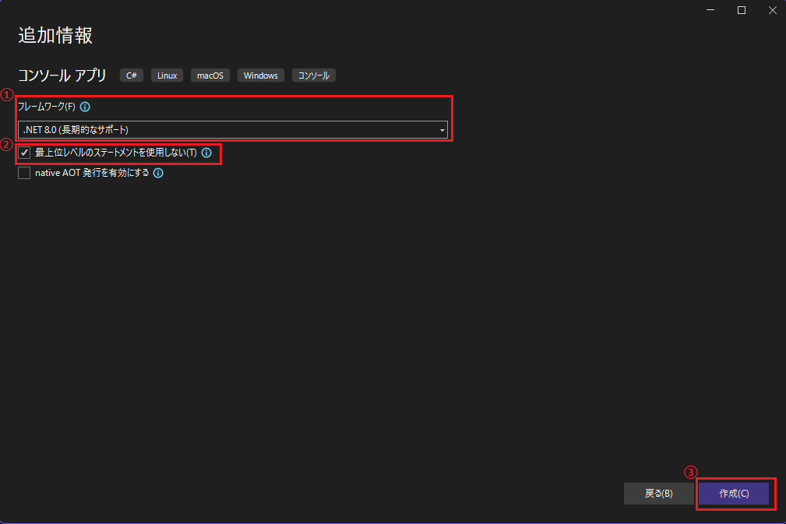

# C#10問：問題ごとにコンソールアプリを作る

初回は講師の画面を見ながら、一緒に問1のプロジェクトを作成します。
問2以降も同じ手順で作成し、Q01〜Q10をそれぞれ別のプロジェクトとして残します。
README・問題文・手順の画像は、このGitHubのページで読みます。ローカルでMarkdownを開く必要はありません。
配布ZIPには全10問のソースコードと、問10のCharacter.csだけが入っています。
各問題の.csの先頭にも、問題文・進め方・提出方法をコメントで記載しています。


## 問題一覧

- [問1](Questions/Q01/Problem.md)
- [問2](Questions/Q02/Problem.md)
- [問3](Questions/Q03/Problem.md)
- [問4](Questions/Q04/Problem.md)
- [問5](Questions/Q05/Problem.md)
- [問6](Questions/Q06/Problem.md)
- [問7](Questions/Q07/Problem.md)
- [問8](Questions/Q08/Problem.md)
- [問9](Questions/Q09/Problem.md)
- [問10](Questions/Q10/Problem.md)

## 必要なもの

- Visual Studio 2022
- .NET 8 SDK（この手順では.NET 8.0を選択します）

Unityの開発ができても、.NET 8 SDKが入っているとは限りません。
手順4で.NET 8.0を選べない場合は、後半の「.NET 8 SDKがない場合」を参照します。

## 1. 新しいプロジェクトの作成を開く

Visual Studio 2022を起動し、「新しいプロジェクトの作成」を押します。
別のプロジェクトを開いている場合は、「ファイル → 新規作成 → プロジェクト」から進められます。



## 2. C#のコンソールアプリを選ぶ

① C#の「コンソール アプリ」を選びます。見つからない場合は上の検索欄で「コンソール」と検索します。
② 「次へ」を押します。

この教材では「コンソール アプリ（.NET Framework）」ではなく、画像の.NET用テンプレートを使います。



## 3. 名前と保存場所を決める

① プロジェクト名を「Q01」にします。問2はQ02、問10はQ10にします。
② 場所は自分の課題用フォルダーを選びます。画像はD:\Classworkの例です。自分のPCの保存場所に合わせてください。
③ 「次へ」を押します。

ソリューション名もQ01にします。「ソリューションとプロジェクトを同じディレクトリに配置する」は画像と同じくチェックを外したままにします。
画像の例では、ソリューションがD:\Classwork\Q01、プロジェクトがD:\Classwork\Q01\Q01に作られます。



配布ZIPは、各プロジェクトの外のフォルダーに展開します。
Q02をQ01のプロジェクト内へ作らず、同じ親フォルダーの下へ作成します。

```text
課題用フォルダー/
├─ CSharpMaterials/  ← 配布ZIPを展開した場所
├─ Q01/              ← 問1のソリューションとプロジェクト
├─ Q02/              ← 問2のソリューションとプロジェクト
└─ … Q10/
```

## 4. フレームワークを選んで作成する

① フレームワークは「.NET 8.0」を選びます。
② 「最上位レベルのステートメントを使用しない」にチェックを入れます。Main関数がある形で作成できます。
③ 「作成」を押します。「native AOT発行を有効にする」はチェックしません。



## 5. 最初の実行をする

作成されたProgram.csを開き、Ctrl+F5で実行します。
Hello, World!が表示されれば、問題コードを入れる準備は完了です。

## 6. その問題のコードを入れる

1. 上の「問題一覧」から問1を読み、展開したZIPのQuestions/Q01/Q01.csを開きます。問題文は.csの先頭でも読めます。
2. Q01.csのコード全体をコピーします。
3. 自分で作ったQ01プロジェクトのProgram.csを開き、内容をすべて置き換えます。既存のMainやHello Worldへ追記しません。
4. 保存します。配布したnamespaceのCSharpPracticeは、そのまま使えます。
5. 問題に沿って修正・実装し、説明コメントを記入します。
6. Ctrl+F5で実行します。F5ならブレークポイントで調べられます。
7. Mainへ自分の入力例を追加し、選んだ理由・実行前の予想・結果もコメントへ書きます。

問1〜5は、最初にコンパイルエラーが出る問題です。エラーを直す前には実行できません。
古いビルドを実行する案内が出ても、今のコードの結果として使わないでください。
問6〜10は関数の中身を実装する問題です。

自分のアプリに反映されるのは、プロジェクト内のProgram.csです。配布元のQ01.csを編集するだけでは反映されません。
配布コード全10問を同じプロジェクトへ追加しません。

## 7. 次の問題へ進む・途中から再開する

問1のProgram.csはそのまま保存して残します。
次は手順1〜6を繰り返し、新しいQ02プロジェクトへQ02.csを入れます。問10まで同じです。
途中から再開するときは、その問題のフォルダーにあるQ01.slnなどのソリューションファイルを開きます。
問題を切り替えるために、完成したProgram.csを別の問題で上書きする必要はありません。

## 問10だけ追加するCharacter.cs

Common/Character.csは講師が用意したHP管理の土台です。
Q10プロジェクトを右クリックし、「追加 → 既存の項目」からCharacter.csを1回だけ追加します。
Program.csとCharacter.csのnamespaceはCSharpPracticeで共通です。そのまま使います。
HpとTakeDamageを使い、Character.csの中身は変更しません。

## コメントに書くこと

問1〜5：
- 【原因】なぜコンパイルエラーになるのか。
- 【対応方法】どこをどう直し、その変更で解消する理由。
- 【エラー番号・内容】修正前に表示されたもの。

問6〜10：
- 【処理の説明】使う値・処理の順序・条件・繰り返し。
- 【条件が必要な理由】条件を省くとどうなるか。

全問：
- 【自分で試した入力】追加した入力と、選んだ理由。
- 【実行前の予想と実際の結果】どうなると考え、実際にどうなったか。

「直した」「動いた」だけではなく、具体的な変数・型・条件を挙げて書きます。
問題のコードをコメントアウトして消すのではなく、コードを直し、説明をコメントへ記入します。
口頭説明や別の解答用紙は使いません。

## 提出

各プロジェクトのProgram.csを、提出用フォルダーへコピーし、Q01.cs〜Q10.csという名前にします。
説明コメントも含めて提出します。実行用のProgram.csは、元のプロジェクトへ残してください。
提出用フォルダーは各プロジェクトの外へ作成します。
プロジェクト一式、bin、obj、.vs、Character.csの提出は不要です。

## .NET 8 SDKがない場合

すでに.NET 8.0を選べてHello Worldを実行できた人は、追加のインストールは不要です。

### Visual Studio Installerから準備する

1. Visual Studioを閉じ、Windowsのスタートメニューから「Visual Studio Installer」を開きます。
2. 使用するVisual Studio 2022の「変更」を押します。
3. 「.NET デスクトップ開発」にチェックを入れます。
4. インストールの詳細や「個別のコンポーネント」で.NET 8関連の項目を確認し、変更を適用します。
5. Visual Studio 2022が古い場合は更新します。
6. Visual Studioを開き直し、手順4で.NET 8.0が選べるか確認します。

### .NET 8.0が見つからない場合

1. Microsoft公式の[.NET 8.0のダウンロード](https://dotnet.microsoft.com/ja-jp/download/dotnet/8.0)を開きます。
2. 「アプリのビルド - SDK」の.NET 8 SDKから、Windows用インストーラーを選びます。通常のIntel／AMD製64ビットPCはx64、Arm搭載PCはArm64です。
3. ダウンロードしたインストーラーを実行し、画面に従ってインストールします。
4. Visual Studioを開き直し、手順4から作成します。

作成に必要なのはSDKです。「ランタイム」だけのインストールでは足りません。
必要ならターミナルで`dotnet --list-sdks`を実行し、8.0.xxxの行があるか確認できます。
テンプレートが表示されない場合はInstallerの「.NET デスクトップ開発」も確認します。
学校のPCでインストールが許可されない場合は、講師へ伝えてください。

参考：[Microsoft公式・Windowsに.NETをインストールする](https://learn.microsoft.com/ja-jp/dotnet/core/install/windows)

## 文字コード

配布した.csはUTF-8 BOM付きです。READMEと問題文はGitHubで読めます。
文字化けした表示のまま保存せず、UTF-8として開き直してください。
