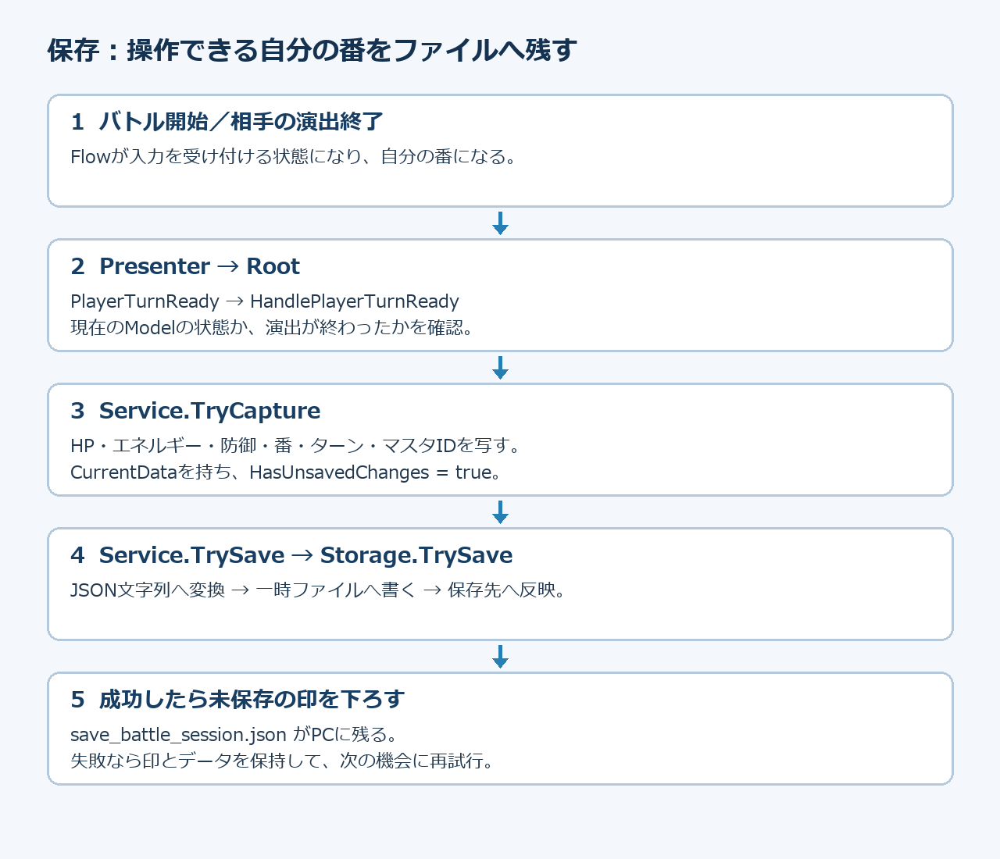
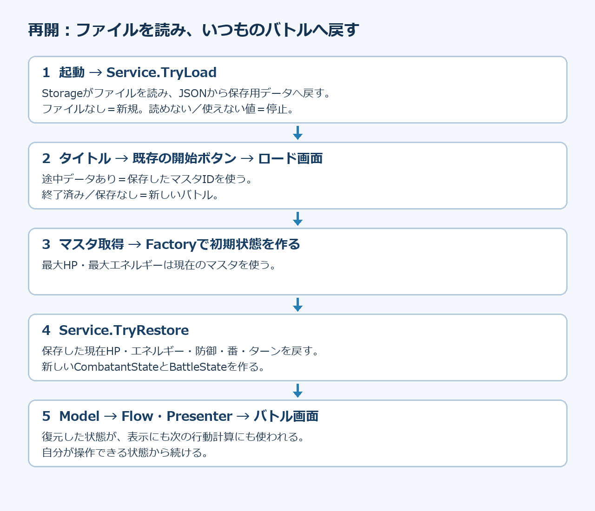
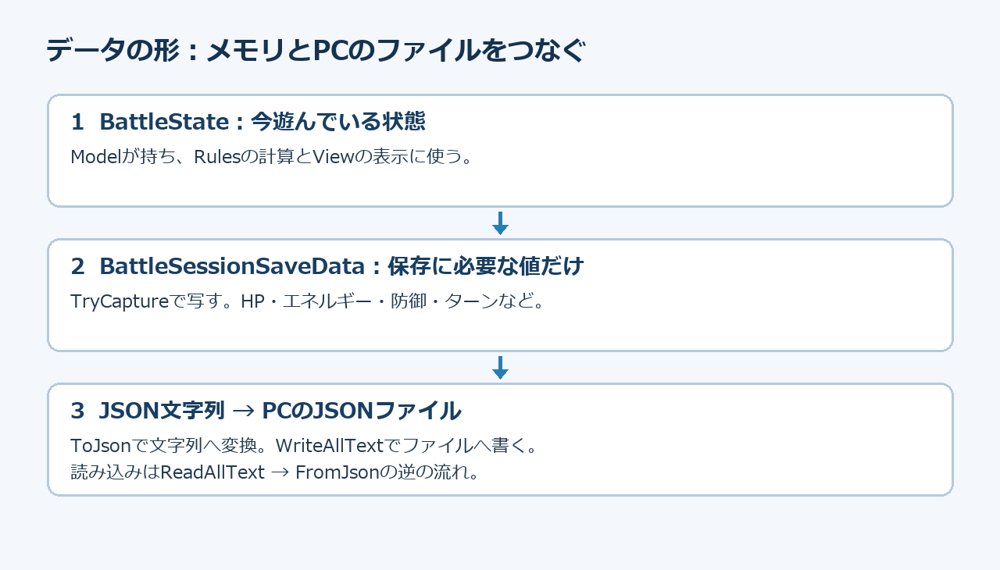
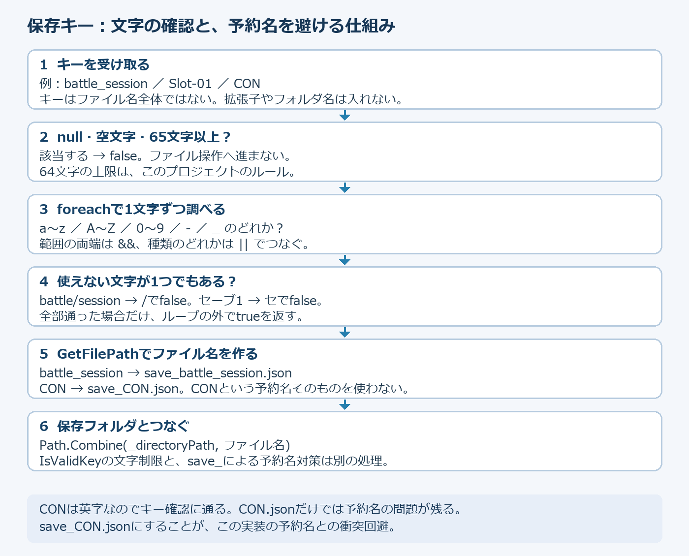
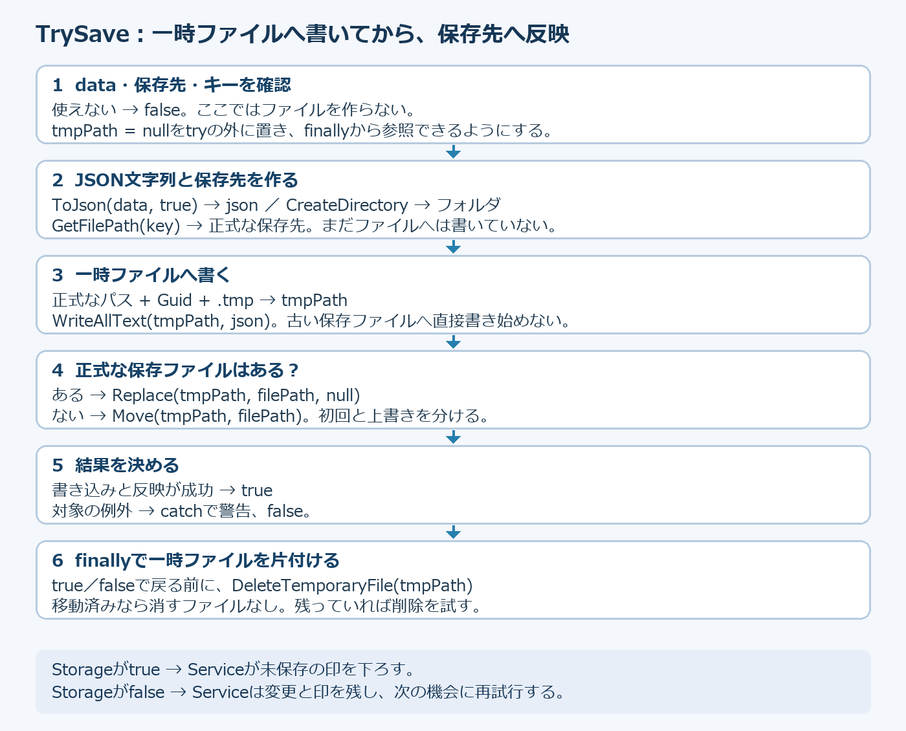
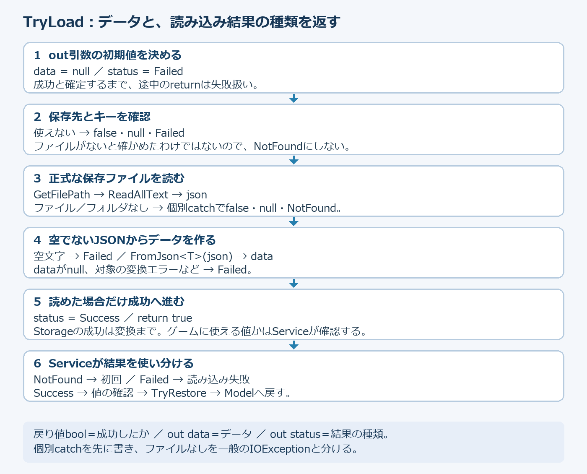
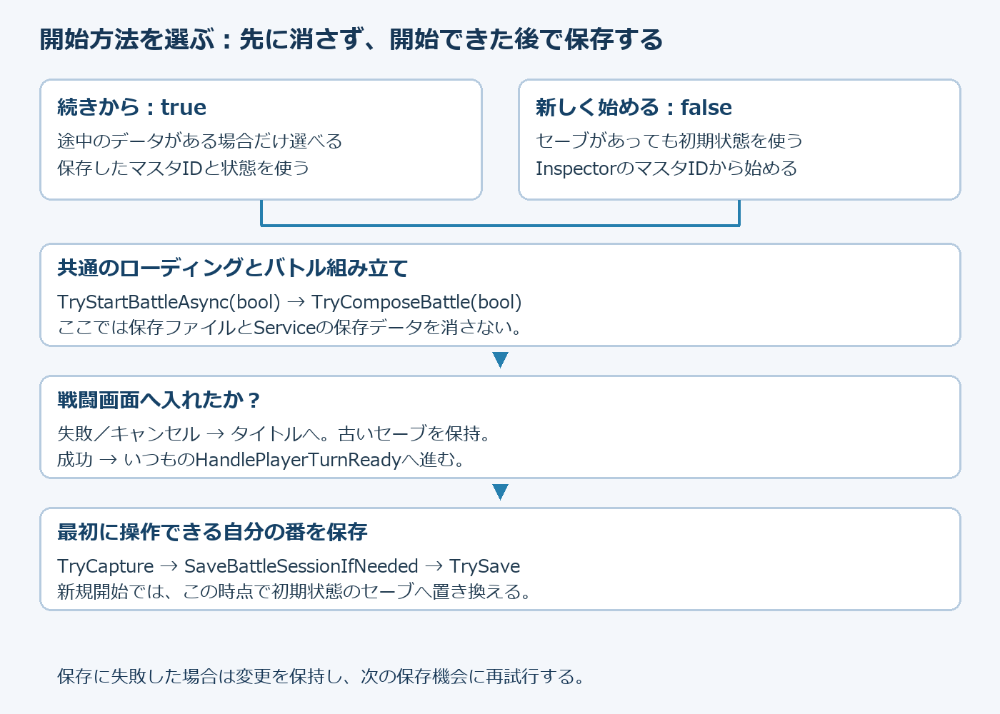

# 第3回：前のバトルの続きから遊べるようにする

## 今日の目標：途中のバトルを保存し、続きから遊べる

自分と相手のHP・エネルギー・防御状態、現在の番とターン番号をPCに保存します。ゲームを閉じて起動し直しても、タイトルの開始ボタンから前のバトルの続きへ戻れるようにします。戦績の保存は後の回に扱います。

3コマ目までに、既存の開始ボタンから保存したバトルを再開できるようにします。4コマ目ではタイトルを「続きから」「新しく始める」の2つに分け、遊び方を選べるようにします。以降の再開操作には「続きから」を使います。

* ゲームを閉じると消えるメモリのデータと、終了後も残るファイルの違いを理解する。
* JSONにする理由と、保存する項目を説明できる。
* 保存データを読み、いつものBattleStateへ戻す仕組みを作る。
* 初回起動と読み込み失敗を分け、既存の保存ファイルを守る。

### どの時点から再開するか

保存するのは「演出が終わり、自分のコマンドを選べるようになったところ」です。最初のバトル開始時と、相手の行動の演出が終わって自分の番になったときに自動保存します。

相手の行動中や演出中に閉じた場合は、最後に保存した自分の番からやり直します。攻撃のアニメーションの途中や、決定前のコマンド選択は復元しません。勝敗が決まったバトルは終了した印を保存し、次の開始は新しいバトルになります。保存に失敗した場合は、最後に保存が成功した時点まで戻ります。

## 保存の流れ



第2回と同じく、入力→Presenter→Flow→Model・Rulesの順で行動が進みます。Modelの値が変わった瞬間には、まだ画面で行動を見せている途中です。BattlePresenter.TryExecuteAsyncでPlayResultAsyncを待ち、TryCompleteEffectsで演出待ちを終えてから、入力できる自分の番かを確認します。

自分の番ならPlayerTurnReadyが今のBattleStateを通知します。GameCompositionRoot.HandlePlayerTurnReadyが受け取り、TryCaptureで保存用データへ写し、SaveBattleSessionIfNeeded→TrySave→JsonFileSaveStorage.TrySaveの順でファイルへ書きます。最初の開始時にも同じHandlePlayerTurnReadyを呼びます。

## 起動して続きへ戻る流れ



起動時、GameCompositionRoot.InitializeGameAsync→TryInitializeBattleSession→BattleSessionService.TryLoadで保存データを読みます。この時点ではまだバトルを作らず、保存データを保持します。その後マスタを読み、タイトルへ進みます。

開始ボタンを押すとロード画面を挟み、TryComposeBattleでバトルを組み立てます。途中のデータがあれば保存したマスタIDを使い、BattleStateFactoryで今のマスタから初期状態を作ります。TryRestoreで保存したHPなどを戻し、その状態を新しいBattleModelへ渡します。FlowとPresenterもいつも通り作るため、復元した値が通常の画面表示と入力処理につながります。

* ファイルがない：初回として新しいバトルを始める。
* 正常な途中データがある：続きから始める。
* 正常な終了データがある：終了済みなので新しいバトルを始める。
* 読み込みに失敗した、対応しない形式や値だった：勝手に新規開始して上書きせず、起動またはバトル準備を止める。

## JSONとは何か、なぜ使うのか

### 1．ゲームを閉じた後にも、何を残す必要があるか

バトル中のHPなどは、BattleModelが持つBattleStateに入っています。これは実行中のメモリにあるデータです。ゲームを閉じると、次の起動で同じBattleStateをそのまま使うことはできません。

例えば、自分のHPが80、相手のHPが60、ターン番号が5のところで終了したとします。次の起動でマスタの初期値だけからバトルを作ると、HPもターン番号も最初に戻ります。「続きから」にするには、その80・60・5と、エネルギー・防御状態などをPCのファイルに残し、次の起動で取り出す必要があります。

ただし、C#のクラスや変数は、そのままの形でテキストファイルに書けるものではありません。保存する値を、ファイルに書ける形に変換します。今回その形として使うのがJSONです。

### 2．JSONは「項目名と値」を文字で表す書き方

JSONはJavaScript Object Notationの略です。名前にJavaScriptが含まれますが、C#を含むさまざまな言語で使えます。JavaScriptのプログラムを書く授業ではありません。

例えば、保存ファイルに書かれる「"_firstHp": 80」は、「_firstHpという項目の値は80」という意味です。項目名があるので、80がHPなのか、エネルギーなのかを区別できます。JSONには攻撃の計算やボタンの処理を書きません。残すのは、計算に使う値です。

今回の保存データをJSONで表すと、次のようになります。これは保存ファイルの内容の例です。C#の関数へ直接貼り付けるコードではありません。

```json
{
  "_version": 1,
  "_firstCombatantId": 1,
  "_secondCombatantId": 1,
  "_firstHp": 80,
  "_secondHp": 60,
  "_firstEnergy": 4,
  "_secondEnergy": 0,
  "_firstIsGuarding": true,
  "_secondIsGuarding": false,
  "_actionSide": 0,
  "_turnNumber": 5,
  "_isFinished": false
}
```

### 3．記号と値を、1つずつ読む

* { と }：1つのデータのまとまりを囲む。今回の例では、途中のバトル1つ分を表す。
* "_firstHp"：項目名。JSONの項目名は半角のダブルクォーテーションで囲む。
* :（コロン）：左が項目名、右がその値。「この項目には、この値」と読む。
* 80：数値。HPやターン番号は数値なので引用符で囲まない。
* true／false：はい／いいえにあたる値。_firstIsGuardingがtrueなら防御中、_isFinishedがfalseならバトルは終了していない。引用符で囲まない。
* ,（カンマ）：項目と項目を区切る。最後の項目の後には付けない。

JSONでは80と"80"は違います。80は数値、"80"は文字列です。文字列は文字として扱うデータで、例えば"Attack"のように引用符で囲みます。今回の保存項目には文字列は使っていませんが、項目名と文字列の値はどちらも引用符で囲む点を区別しましょう。

改行や字下げは、人が読みやすくするためです。同じ項目と値なら、1行にまとめたJSONでもデータの意味は変わりません。このプロジェクトのToJson(data, true)のtrueは、読みやすい改行・字下げを付ける指定です。

* _actionSide：C#のBattleSideを数値で表す。このプロジェクトではFirstが0、Secondが1。0は「0ターン目」という意味ではない。
* _turnNumber：現在のターン番号。例では5。
* _version：保存形式の番号。ターン番号やUnityのバージョンではない。読み込む側が対応する形式かを判断するために持つ。
* _firstCombatantId／_secondCombatantId：どのマスタを使うかを示すID。HPの値とは別。

JSONはC#とは書き方が違います。項目名をシングルクォーテーションで囲む、最後にカンマを残す、//でコメントを書く、といった形はJSONの書き方ではありません。保存ファイルを手書きする課題ではなく、実際のJSONはJsonUtilityに作ってもらいます。

### 4．今回JSONを選ぶ理由

* ファイルをテキストエディターで開き、HPやターン番号が何になっているか読める。
* 項目名と値の組なので、残したい情報を整理しやすい。
* UnityにあるJsonUtilityを使い、保存用のC#クラスと文字列を行き来できる。

JSON以外に、独自のバイナリ形式などで保存する方法もあります。今回は保存と再開の仕組みを学び、ファイルの中身も読みたいのでJSONを使います。.jsonという拡張子を付けただけで、自動的に保存や読み込みができるわけではありません。

### 5．BattleStateから、何をJSONへ写すか



BattleSessionSaveDataは保存専用の入れ物です。BattleState全体やPresenter、Buttonを保存するのではなく、続きから遊ぶための値だけを写します。JsonUtilityが読むのはフィールドです。[Serializable]をクラスに付け、privateフィールドには[SerializeField]を付けます。読み取り用プロパティの名前が、そのままJSONの項目になるわけではありません。

例えば、BattleSessionSaveDataのprivateフィールド_firstHpに80を入れたら、JSONには"_firstHp": 80として残ります。FirstHpという読み取り用プロパティは、C#側でその値を読む入口です。今回のJSONの項目名になるのは、プロパティ名ではなくフィールド名です。

最大HPや最大エネルギーは現在のマスタから取得し、現在HPなどの途中で変わる値を保存します。ButtonやPresenterまで保存する必要はありません。データだけに絞ることで、起動し直して作ったModel・View・Presenterへ戻せます。

### 6．C#のデータ、JSON文字列、ファイルは別のもの

保存する流れを3段階に分けて読みます。

* TryCapture：BattleStateの値をBattleSessionSaveDataへ写す。まだメモリにあるだけ。
* JsonUtility.ToJson：その保存用データをJSON形式のstringへ変換する。stringも、まだメモリにある文字列。
* File.WriteAllText：JSON文字列をPCのファイルへ書く。ここで終了後も残せる形になる。

C#のデータを保存・送信できる形へ変換することを「シリアライズ」と呼びます。今回のToJsonがその処理です。逆にJSONからC#のデータへ戻すことを「デシリアライズ」と呼びます。今回のFromJsonがその処理です。言葉だけで覚えるより、「データ→文字列」「文字列→データ」と対応させましょう。

次の4行は、用意済みのJsonFileSaveStorage.csから取り出したものです。読み比べるための抜粋なので、この4行をまとめて新しい関数へ追加しません。

```csharp
string json = JsonUtility.ToJson(data, true);
File.WriteAllText(tmpPath, json);
string json = File.ReadAllText(filePath);
data = JsonUtility.FromJson<T>(json);
```

上の2行はTrySave<T>の中、下の2行はTryLoad<T>の中です。同じ関数にstring jsonを2回書くという意味ではありません。dataは保存用のC#データ、jsonはJSON文字列、tmpPathは書き込み途中の一時ファイルの場所、filePathは保存済みファイルの場所です。Tは扱うクラスの型で、今回Serviceから頼むときはBattleSessionSaveDataになります。

保存処理では一時ファイルへ書き終えてから、File.MoveまたはFile.Replaceで正式な保存ファイルに反映します。ToJsonが成功しただけでは保存完了ではなく、書き込みと反映まで成功した場合に未保存の印を下ろします。

### 7．読み込めたら、すぐに続きから遊べるのか

ロードは、保存の逆の流れです。

* File.ReadAllText：PCのファイルから文字列を読む。
* JsonUtility.FromJson：文字列をBattleSessionSaveDataへ戻す。
* IsValidData：形式番号やHP、番などが、このゲームで使える内容かを調べる。
* TryRestore：保存した現在値とマスタの最大値から、新しいCombatantState・BattleStateを作る。
* BattleModelへ渡す：復元した状態を、画面表示と次の行動の計算に使う。

例えば"_firstHp": -10は、数値を持つJSONとしての形は読めても、ゲームのHPとしては使いたくない値です。「JSONとして読める」と「バトルに使える」を分けて調べます。JsonUtilityはゲームのルールまでは知りません。また、C#のフィールドに対応しないJSONの項目は無視されるため、項目の綴りを間違えても必ず読み込みエラーになるとは限りません。

JSONは暗号化ではありません。今回の保存ファイルは中身を読める文字のファイルで、改ざんを完全に防ぐ仕組みではありません。まずは必要な値を保存し、使える内容を確かめ、バトルへ戻す流れを作ります。

JsonUtilityの変換対象と使い方：[Unity公式：JSON serialization](https://docs.unity3d.com/6000.3/Documentation/Manual/json-serialization.html)

## 新しく読むクラスと変数

### BattleSessionSaveData：保存したい値を入れる

* FirstCombatantId／SecondCombatantId：双方のマスタID。続きでも同じキャラクターのマスタを使う。
* FirstHp／SecondHp、FirstEnergy／SecondEnergy：終了後も戻したい現在値。
* FirstIsGuarding／SecondIsGuarding：防御が有効か。
* ActionSide／TurnNumber：現在の番とターン番号。保存可能な途中データは自分の番だけ。
* IsFinished：このバトルは終了済みか。trueなら再開しない。
* Version／CurrentVersion：読み込んだ形式と、このプログラムが対応する形式。
* コンストラクター：BattleStateとマスタIDを受け取り、上の値をフィールドへ写す。

最大HP・最大エネルギーは保存しません。再開時に現在のマスタから受け取ります。現在HPだけを画面に戻しても、Modelの状態が変わらなければ次の行動で元に戻ってしまいます。復元先は画面の文字ではなくBattleStateです。

### BattleSessionService：保存と復元の手順を管理する

* _storage：ファイルの読み書きを頼むISaveStorage。コンストラクターで受け取る。
* SaveKey：battle_sessionという保存の名前。ファイル名を決める材料。
* CurrentData：今保持している保存用データ。BattleModelの現在状態とは別。
* IsInitialized：最初の読み込みが終わったか。終わる前の上書きを防ぐ。
* HasUnsavedChanges：ファイルへまだ書けていない変更があるか。
* HasResumeData：途中のデータがあり、終了していないか。
* TryLoad：初回と失敗を分け、読めた値をIsValidDataで調べてから採用する。
* IsValidData：形式番号、ID、負のHP・エネルギー、番とターン番号、終了状態の整合性を調べる。JSONが読めたことと、ゲームで使えることは別。

### ISaveStorage・SaveLoadStatus・JsonFileSaveStorage：ファイル操作の土台

ISaveStorageは「保存と読み込みを頼める相手」の約束です。TrySave<T>のTは保存するクラス、TryLoad<T>のout dataは読み込んだデータ、out statusは結果の種類です。今回はTにBattleSessionSaveDataを使います。

SaveLoadStatus.Successはデータを読み取れた状態、NotFoundはファイルやフォルダがない状態、Failedは読み込みなどに失敗した状態です。NotFoundだけを初回として扱います。TryLoadがtrueでも、Service側で値の内容を確認します。

JsonFileSaveStorageの_directoryPathは保存フォルダです。GetFilePathは保存キーからsave_battle_session.jsonの名前を作ります。TrySaveはJSONに変換し、一時ファイルに書き終えてから保存ファイルへ反映します。初回はFile.Move、既存ファイルがあればFile.Replaceを使います。書き込み途中に既存データを直接壊しにくくするためです。DeleteTemporaryFileは残った一時ファイルを片付けます。

### なぜここではtry／catchを使うのか

入力値を調べても、書き込む瞬間に容量不足やアクセス権の問題が起こることがあります。ファイル操作をtryで実行し、保存処理で想定する例外をcatchしてfalseを返します。IsStorageExceptionは対象の例外を選ぶ関数です。finallyは成功・失敗にかかわらず一時ファイルを片付けます。すべてのプログラムの間違いを隠すためのcatchではありません。

### 保存キーの文字を絞る理由と、Windowsの予約名

#### 保存キーとファイル名は別

keyは保存データを区別する名前です。今回はbattle_sessionです。GetFilePathはそのキーへsave_と.jsonを付け、save_battle_session.jsonというファイル名にします。Path.Combineで保存フォルダとその名前をつなぎます。

例えば、保存先フォルダがSaves、keyがbattle_sessionなら、Saves/save_battle_session.jsonになります。キーへ.jsonやフォルダ名を入れる必要はありません。ゲーム画面に表示する名前とも別のものです。

#### Windowsの予約ファイル名とは

Windowsには、機器などを表すために特別な意味を持つ名前があります。普通のファイル名として使わない代表例はCON・PRN・AUX・NUL・COM1〜COM9・LPT1〜LPT9です。単に英字と数字でできている名前でも、通常のファイル名として自由に使えるわけではありません。

CON.jsonやNUL.txtのように拡張子を付けるだけでも、この予約名の問題は避けられません。このプロジェクトでは、キーをそのままファイル名にせずsave_を先頭に付けます。keyがCONでも、実際のファイル名はsave_CON.jsonとなり、予約名のCONそのものとは別の名前になります。

Windowsの名前のルール：[Microsoft公式：Naming Files, Paths, and Namespaces](https://learn.microsoft.com/en-us/windows/win32/fileio/naming-a-file)

#### IsValidKeyが確認すること

* nullまたは空文字ならfalse。空文字は文字が1つもない状態。
* key.Lengthが64を超えたらfalse。64文字は通り、65文字は通らない。64はこのプロジェクトで決めた上限で、Windows全体のファイル名の上限という意味ではない。
* foreachでキーを1文字ずつ取り出す。characterは今調べている1文字。
* 小文字a〜z、大文字A〜Z、数字0〜9、半角の-または_なら、その文字のisAllowedはtrue。
* 許可していない文字が1つでもあれば、その場でreturn false。
* 最後の文字まで通った場合だけ、foreachの外のreturn trueへ進む。



コードの(character >= 'a' && character <= 'z')は「a以上で、かつz以下」です。>=と<=で範囲を調べ、&&は両方を満たす条件です。charには文字に対応する番号があるので、この比較で半角小文字の範囲を調べられます。

次の||は「どれか1つを満たせばよい」という条件です。小文字・大文字・数字・ハイフン・アンダースコアのどれかに当てはまれば通します。if (!isAllowed)の!はtrue／falseを反転するので、「使えない文字ならfalseを返す」と読みます。

* battle_session：すべて許可した文字なのでtrue。
* Slot-01：大文字・小文字・数字・ハイフンなのでtrue。
* CON：英字なのでIsValidKeyはtrue。予約名を列挙して拒否する関数ではない。GetFilePathのsave_で名前の衝突を避ける。
* battle/session：/のところでfalse。フォルダを分ける記号をキーへ混ぜない。
* ../battle：最初の.でfalse。上のフォルダを指す書き方をキーへ入れない。
* battle session：空白のところでfalse。
* セーブ1や全角のＡ：半角の英数字の範囲ではないのでfalse。

Windowsでは日本語のファイル名自体を使える場合もあります。この関数が日本語を通さないのは、このゲームのキーのルールを絞っているためです。日本語の画面表示を禁止する処理ではありません。

「許可していない記号をキーへ混ぜない」はIsValidKeyの役割、「CONなどの予約名と同じファイル名にしない」はGetFilePathのsave_の役割です。別々の工夫として覚えましょう。

### コードを書く前に：ファイルと位置の読み方

今回ライブコーディングで開くファイルは次の4つです。UnityのProjectウィンドウではAssetsからたどります。

* Assets/TurnForge/Scripts/Infrastructure/Saving/JsonFileSaveStorage.cs：保存・読み込みと補助関数を実装する。
* Assets/TurnForge/Scripts/Battle/Saving/BattleSessionService.cs：TryLoad・TryRestore・TryCapture・TrySaveを実装する。
* Assets/TurnForge/Scripts/UI/Battle/BattlePresenter.cs：PlayerTurnReadyの宣言・通知・解除を追加する。
* Assets/TurnForge/Scripts/Composition/GameCompositionRoot.cs：通知の受け取りと保存処理への接続を追加する。

「関数を変更」は、既存の同名の関数の宣言から最後の}までを置き換えることです。同じ名前の関数をもう1つ追加しません。「関数を追加」は、指定した関数の最後の}より下、クラスの最後の}より上に書くことです。別の関数の中には書きません。

BattleSessionService内の関数は、上からTryLoad→TryRestore→TryCapture→TrySave→IsValidDataの順を目印にします。先に用意されているTryRestoreの枠は2コマ目で実装します。実際に呼ばれる順番と、ファイルの上からの並びは別です。位置をそろえるのは、コードを探しやすくするためです。

## 1コマ目：今のバトルを保存用データへ写す

* 保存と再開の全体図、JSONとファイルの違いを読む。
* BattleSessionSaveDataとService、Storageの役割を確認する。
* TryCaptureとTrySaveを実装する。


### ライブコーディング：JSONファイルへ書く保存基盤

学生配布版のJsonFileSaveStorageは、TrySaveとTryLoadがfalseを返す未実装の枠です。このままではServiceとRootをつないでも保存・再開できません。完成版のmainブランチと同じ読み書きの処理を、既存のファイルへ授業中に実装します。

#### ファイルとusing

* ファイル：Assets/TurnForge/Scripts/Infrastructure/Saving/JsonFileSaveStorage.cs
* 作業：既存のクラス・_directoryPath・コンストラクターは使う。以下のusingをnamespaceより上へ追加する。既にあれば重複追加しない。


```csharp
using System;
using System.IO;
using System.Security;
using UnityEngine;
```

#### ファイル操作を助ける4つの関数を追加する

* 位置：既存のTryLoadの最後の}の下、JsonFileSaveStorageクラスの最後の}より上。
* GetFilePath：保存キーからsave_キー.jsonのパスを作る。引数keyはファイルを区別する名前。
* IsValidKey：keyの長さと使用可能な文字を調べる。characterはforeachで1文字ずつ取り出した文字、isAllowedは使える文字かを表す。
* IsStorageException：ファイルの読み書きで起こりうる例外かを調べる。exceptionはcatchで受け取った問題の情報。
* DeleteTemporaryFile：失敗時に残った一時ファイルを片付ける。pathは一時ファイルの場所。

これらは今回初めて追加する関数です。前の「try／catch」「保存キーの文字を絞る理由」の説明と対応させて読みます。次の順に追加してください。


```csharp
private string GetFilePath(string key)
{
    // 接頭辞を付け、Windowsの予約ファイル名との衝突を避ける
    return Path.Combine(_directoryPath, $"save_{key}.json");
}
```

```csharp
private static bool IsValidKey(string key)
{
    if (string.IsNullOrEmpty(key) || key.Length > 64)
    {
        return false;
    }

    // 英数字・ハイフン・アンダースコアだけを許可する
    foreach (char character in key)
    {
        bool isAllowed =
           (character >= 'a' && character <= 'z')
           || (character >= 'A' && character <= 'Z')
           || (character >= '0' && character <= '9')
           || character == '-'
           || character == '_';

        if (!isAllowed)
        {
            return false;
        }
    }

    return true;
}
```

```csharp
private static bool IsStorageException(Exception exception)
{
    return exception is IOException ||
           exception is UnauthorizedAccessException ||
           exception is SecurityException ||
           exception is ArgumentException ||
           exception is NotSupportedException;
}
```

```csharp
private static void DeleteTemporaryFile(string path)
{
    if (string.IsNullOrEmpty(path))
    {
        return;
    }

    try
    {
        // ファイル存在しない場合は何もしない
        File.Delete(path);
    }
    catch (Exception exception) when (IsStorageException(exception))
    {
        Debug.LogWarning($"一時ファイルを削除できませんでした : {exception.Message}");
    }
}
```

#### TrySaveを実装する

* 作業：同じJsonFileSaveStorage.csにあるTrySave<T>の宣言から最後の}までを置き換える。BattleSessionService.TrySaveとは別の関数。
* data：保存したいC#のデータ。Tはそのクラスの型。
* json：ToJsonで作る文字列。tmpPathは書き込み途中の一時ファイル、filePathは正式な保存先。
* Guid.NewGuid：一時ファイル名が重ならないようにする識別子。成功後にMove／Replaceで正式な保存先へ反映する。
* finally：成功・失敗のどちらでも一時ファイルの後始末を頼む。保存に失敗した場合はfalseをServiceへ返す。


```csharp
public bool TrySave<T>(string key, T data) where T : class
{
    if (data == null || string.IsNullOrWhiteSpace(_directoryPath) || !IsValidKey(key))
    {
        return false;
    }

    // 書き込み途中のファイルを既存データから分離する
    string tmpPath = null;

    try
    {
        // 保存するJSON文字列
        string json = JsonUtility.ToJson(data, true);

        Directory.CreateDirectory(_directoryPath);

        // キーから決定する保存先
        string filePath = GetFilePath(key);

        tmpPath = $"{filePath}.{Guid.NewGuid().ToString("N")}.tmp";

        File.WriteAllText(tmpPath, json);

        if (File.Exists(filePath))
        {
            // 書き込み完了後に既存ファイルを置き換える
            File.Replace(tmpPath, filePath, null);
        }
        else
        {
            // 初回保存では一時ファイルを保存先へ移動する
            File.Move(tmpPath, filePath);
        }

        return true;
    }
    catch (Exception exception) when (IsStorageException(exception))
    {
        Debug.LogWarning($"セーブに失敗しました：{exception.Message}");
        return false;
    }
    finally
    {
        // 失敗して残った一時ファイルを削除
        DeleteTemporaryFile(tmpPath);
    }
}
```

#### TrySaveの中を、実行される順番で読む

ここで説明するのはJsonFileSaveStorage.TrySave<T>です。Service側のTrySaveは「変更があるか・保存済みにしてよいか」を管理し、Storage側は「JSONに変換してファイルへ書く」を担当します。



1．最初のifで、dataがnull、保存先が空・空白だけ、キーが使えない、のどれかならfalseを返します。まだファイルは作りません。where T : classは、Tにクラス型を使う指定です。今回のdataはBattleSessionSaveDataになります。

2．tmpPathをnullで用意します。後のtryの途中で失敗しても、finallyからこの変数を参照できるように、tryの外で宣言しています。一時ファイルを作る前の失敗ならnullのままなので、DeleteTemporaryFileは何もせず戻れます。

3．JsonUtility.ToJson(data, true)で保存用データをJSON文字列へ変換します。trueは改行・字下げを付ける指定で、「保存成功」という意味ではありません。jsonはまだメモリ上の文字列です。

4．Directory.CreateDirectory(_directoryPath)で保存フォルダを用意します。既にあるフォルダはそのまま使います。GetFilePath(key)で、正式な保存先のfilePathを作ります。

5．正式なパスの後ろにGuidと.tmpを付け、tmpPathを作ります。例えばsave_battle_session.json.識別子.tmpの形です。Guid.NewGuid().ToString("N")は識別子をハイフンなしの文字列にする指定です。識別子の値は毎回変わるので、この名前を手書きする必要はありません。

6．File.WriteAllText(tmpPath, json)で、一時ファイルへ文字列を書きます。現在の保存ファイルへ直接書き込み始めず、別の場所に書き終えてから反映する工夫です。

7．File.Exists(filePath)で正式な保存ファイルがあるかを見ます。ある場合はFile.Replace(tmpPath, filePath, null)、ない場合はFile.Move(tmpPath, filePath)です。Replaceの第1引数は新しい内容の一時ファイル、第2引数は置き換える保存ファイル、第3引数のnullはバックアップファイルを作らない指定です。初回は置き換える相手がないのでMoveを使います。

8．書き込みと反映までできたらtrueを返します。容量不足・アクセス権など、IsStorageExceptionで対象にした例外が起きたら、catchで警告を出してfalseを返します。全ての例外をまとめて隠す処理ではありません。

9．成功でも失敗でも、finallyがDeleteTemporaryFile(tmpPath)を呼びます。tryやcatchの中にreturnがあっても、戻る前にfinallyを通ります。Move／Replaceで一時ファイルが移動済みなら、元の一時パスにはファイルがないため削除するものはありません。残っていた場合は片付けます。削除の失敗はDeleteTemporaryFile内で警告にします。

Storageがtrueを返した後に、Service.TrySaveがHasUnsavedChangesをfalseにします。Storage側からその印を変更しません。StorageがfalseならServiceは印を残すので、次の保存機会にもう一度頼めます。一時ファイルを使うのは書き込み途中の内容を既存の保存ファイルから分ける工夫で、あらゆる故障で必ず元のファイルが残ることを保証する仕組みではありません。

File.Replaceの引数：[Microsoft公式：File.Replace](https://learn.microsoft.com/en-us/dotnet/api/system.io.file.replace)

ここではTryLoadはまだ未実装です。2コマ目に読み込み処理を実装し、Rootからの呼び出しはその後につなぎます。

### TryCapture：今の状態を写す

stateはModelが持つ今のBattleState、firstIdとsecondIdは使用中のマスタIDです。newで保存用データを作り、使える値か調べてからCurrentDataに持ちます。この時点ではメモリに写しただけなので、HasUnsavedChangesをtrueにします。

#### 書く場所

* ファイル：Assets/TurnForge/Scripts/Battle/Saving/BattleSessionService.cs
* 作業：BattleSessionServiceクラス内のTryCaptureを変更する。宣言から最後の}までを、下のコードに置き換える。
* 位置：用意済みのTryRestoreのすぐ下、TrySaveのすぐ上。枠がない版で追加する場合も、この位置に書く。


```csharp
public bool TryCapture(BattleState state, ulong firstId, ulong secondId)
{
    if (!IsInitialized || state?.FirstCombatant == null || state.SecondCombatant == null)
    {
        return false;
    }

    var data = new BattleSessionSaveData(state, firstId, secondId);
    if (!IsValidData(data))
    {
        return false;
    }

    CurrentData = data;
    HasUnsavedChanges = true;
    return true;
}
```


### TrySave：成功したら未保存の印を下ろす

初期化前には保存せず、変更がなければ書き込みません。_storage.TrySaveが失敗したらfalseを返し、未保存の印は残します。成功して初めてHasUnsavedChangesをfalseにする順序が大切です。

#### 書く場所

* ファイル：Assets/TurnForge/Scripts/Battle/Saving/BattleSessionService.cs
* 作業：BattleSessionServiceクラス内のTrySaveを変更する。宣言から最後の}までを、下のコードに置き換える。
* 位置：TryCaptureのすぐ下、IsValidDataのすぐ上。JsonFileSaveStorage.csにもTrySaveがあるが、今回変更するのはService側。


```csharp
public bool TrySave()
{
    if (_storage == null || !IsInitialized)
    {
        return false;
    }

    if (!HasUnsavedChanges)
    {
        return true;
    }

    if (!IsValidData(CurrentData) || !_storage.TrySave(SaveKey, CurrentData))
    {
        return false;
    }

    HasUnsavedChanges = false;
    return true;
}
```

## 2コマ目：保存した値からバトルを作り直す

* 起動時のTryLoadと、開始時のTryRestoreを分けて考える。
* TryRestoreが返した状態をBattleModelへ渡す流れを読む。
* BattleStateとCombatantStateを作り直す。

### ライブコーディング：保存ファイルを読み込む

* ファイル：Assets/TurnForge/Scripts/Infrastructure/Saving/JsonFileSaveStorage.cs
* 作業：既存のTryLoad<T>の宣言から最後の}までを、次のコードへ置き換える。位置はTrySaveの下、1コマ目に追加したGetFilePathの上。
* out data：読み込んだデータを呼び出し元へ返す。失敗時はnull。
* out status：Success／NotFound／Failedを呼び出し元へ返す。初期値はFailedで、ファイルやフォルダがない場合だけNotFoundにする。
* FileNotFoundException／DirectoryNotFoundException：ファイル・フォルダが存在しない場合の例外。それ以外の読み込み失敗を初回と混ぜない。


```csharp
public bool TryLoad<T>(string key, out T data, out SaveLoadStatus status) where T : class
{
    data = null;
    status = SaveLoadStatus.Failed;

    if (string.IsNullOrWhiteSpace(_directoryPath) || !IsValidKey(key))
    {
        return false;
    }

    try
    {
        // キーに対応する保存先
        string filePath = GetFilePath(key);

        // ファイルに保存されたJSON文字列
        string json = File.ReadAllText(filePath);

        if (string.IsNullOrEmpty(json))
        {
            return false;
        }

        data = JsonUtility.FromJson<T>(json);

        if (data == null)
        {
            return false;
        }

        status = SaveLoadStatus.Success;
        return true;
    }
    catch (FileNotFoundException)
    {
        // 初回起動など、保存ファイルが存在しない
        status = SaveLoadStatus.NotFound;
        return false;
    }
    catch (DirectoryNotFoundException)
    {
        // 初回保存前で、保存先フォルダーが存在しない
        status = SaveLoadStatus.NotFound;
        return false;
    }
    catch (Exception exception) when (IsStorageException(exception))
    {
        Debug.LogWarning($"セーブの読み込みに失敗しました：{exception.Message}");
        data = null;
        return false;
    }
}
```

#### TryLoadの中を、実行される順番で読む

TryLoadは戻り値のboolだけでなく、out dataとout statusも呼び出し元へ返します。boolは読み込み処理が成功したか、dataは取り出したデータ、statusはどういう結果だったかです。falseだけでは「初回でファイルがない」と「ファイルはあるが読めなかった」を区別できません。



1．data = null、status = Failedで始めます。この後の途中のreturnでは、成功だと書き換えるまで失敗のままです。どの道で戻ってもout引数へ値を入れるためでもあります。

2．保存先とキーを確認します。保存先が空・空白だけ、またはIsValidKeyがfalseなら、その場でfalseを返します。ファイルがないことを確かめたわけではないので、NotFoundには変えません。

3．GetFilePathで正式な保存先を作り、File.ReadAllText(filePath)で内容を文字列へ読みます。保存時の.tmpファイルではなく、save_battle_session.jsonを読みます。ReadAllTextは読み込み後にファイルを閉じます。

4．jsonがnullまたは空文字ならfalseを返します。ファイルが存在しても中身が空なら、保存用データは作れません。statusはFailedのままです。

5．JsonUtility.FromJson<T>(json)で、文字列からTのデータを作ります。今回はBattleSessionSaveDataです。変換の結果がnullならfalseを返し、変換中に対象の例外が起きた場合はcatchへ進みます。

6．データを作れた場合だけstatus = Success、return trueにします。ただしStorageの成功は「文字列からデータを取り出せた」ことです。HPや保存形式の番号がゲームで使えるかは、呼び出し元のService.IsValidDataで別に調べます。

7．ReadAllTextなどでFileNotFoundExceptionまたはDirectoryNotFoundExceptionになったら、statusをNotFoundにしてfalseを返します。初回起動で保存ファイルもフォルダもまだない場合を、Serviceが新規開始として扱えるようにします。

8．それ以外でIsStorageExceptionに当てはまる例外は、警告を出し、dataをnullへ戻し、falseを返します。statusはFailedのままです。例えばアクセス権の問題で読めないファイルを「初回」と決めつけて上書きしません。

* 読めてデータを作れた：true／dataあり／Success。次にService側で値を調べる。
* ファイルまたは保存先フォルダがない：false／dataはnull／NotFound。Serviceが初回として扱う。
* キーが使えない、空ファイル、対象の読み込み・変換エラー：false／dataはnull／Failed。Serviceが読み込み失敗として扱う。

catchは上から当てはまるものを使います。FileNotFoundExceptionとDirectoryNotFoundExceptionはIOExceptionの仲間でもあるので、先に個別のcatchでNotFoundへ分けます。まとめたcatchへ先に入れてしまうと、ファイルなしを通常の失敗と混ぜてしまいます。

この関数はファイルを読むだけで、HPを直接画面へ表示したりBattleModelを作ったりしません。Serviceが保存データを持ち、TryRestoreとRootの組み立てを通して、いつものバトルへ戻します。

### ライブコーディング：BattleSessionService.TryLoad

Storageの読み込みに続いて、Service側のTryLoadも実装します。JsonFileSaveStorage.TryLoad<T>は「ファイルを読んでデータを取り出す」、BattleSessionService.TryLoadは「その結果を初回・失敗に分け、使えるデータだけ保持する」という役割です。

#### 書く場所

* ファイル：Assets/TurnForge/Scripts/Battle/Saving/BattleSessionService.cs。
* 作業：既存のTryLoad()の宣言から最後の}までを、下のコードへ置き換える。Storage側のTryLoad<T>は変更しない。
* 位置：BattleSessionService(ISaveStorage storage)のコンストラクターの閉じる}の下、TryRestoreのすぐ上。枠がない場合もこの位置へ追加する。クラス内に同じTryLoadを2つ作らない。
* ファイル先頭のusing TF.Infrastructure.Saving;でISaveStorageとSaveLoadStatusを使う。既にある場合は追加しない。

#### この関数で使うもの

* _storage：ファイルの読み書きを頼む相手。コンストラクターで受け取る。
* SaveKey：このバトルの保存データを識別する"battle_session"という既存の定数。
* HasUnsavedChanges：まだ保存していない変更があるか。trueの間に読み直すと変更を失うため、読み込みを断る。
* IsInitialized：起動時の読み込み判断が終わったか。ファイルがない初回も、正常に判断できたのでtrueになる。
* data：Storageから受け取るBattleSessionSaveData。out varは、呼び出し先から受け取る変数をその場で宣言する書き方。
* status：Storageから受け取るSaveLoadStatus。NotFoundだけを、保存ファイルがまだない初回として扱う。
* IsValidData：このServiceの末尾にある既存の確認関数。保存形式の番号、ID、HPやエネルギー、ターン、保存できる区切りかを調べる。ここでは呼び出し、確認処理を重ねて作らない。
* CurrentData：使えると判断した保存データを保持する。BattleStateへの復元は、この後のTryRestoreが担当する。

```csharp
/// <summary>
/// 初回と失敗を分け、保存データを読み込む。
/// </summary>
public bool TryLoad()
{
    if (_storage == null || HasUnsavedChanges)
    {
        return false;
    }

    if (IsInitialized)
    {
        return true;
    }

    if (!_storage.TryLoad<BattleSessionSaveData>(SaveKey, out var data, out var status))
    {
        if (status != SaveLoadStatus.NotFound)
        {
            return false;
        }

        // 初回は途中のバトルを持たず、新規開始する。
        IsInitialized = true;
        return true;
    }

    if (!IsValidData(data))
    {
        return false;
    }

    CurrentData = data;
    IsInitialized = true;
    return true;
}
```

#### 実行される順に読む

* 保存先がない、または未保存の変更がある場合はfalse。現在のデータを読み込みで置き換えない。
* 既に初期化済みならtrue。ファイルの読み直しは行わない。このTryLoadはゲーム中に何度もロードするための関数ではない。
* StorageへBattleSessionSaveDataの読み込みを頼む。!は「成功しなかった場合に、この中へ進む」という意味。
* Storageがfalseを返し、statusがNotFoundなら初回としてIsInitializedをtrueにする。CurrentDataはnullのままなので、途中のバトルはない。ファイルがないことをゲーム起動の失敗にはしない。
* NotFound以外の読み込み失敗はfalse。失敗を初回として扱って、読めなかった保存データを上書きする進め方にはしない。
* StorageがtrueでもIsValidDataがfalseなら採用しない。JSONをデータへ戻せたことと、ゲームで使える値であることは別。
* 正常なデータだけCurrentDataへ入れ、IsInitializedをtrueにして成功を返す。読み込んだだけなのでHasUnsavedChangesはtrueにしない。

ファイルがない初回では「true・IsInitializedはtrue・CurrentDataはnull」、正常な保存があれば「true・IsInitializedはtrue・CurrentDataに保存データ」、読み込み失敗や値の不正では、初期化前の呼び出しは「false・IsInitializedはfalse」です。RootのTryInitializeBattleSessionはfalseを受け取ると起動を中止するので、失敗したデータをそのまま新しいバトルとして保存しません。

この後TryRestoreとRootの接続を実装します。StorageとServiceの両方のTryLoadを完成させてから、Root.InitializeGameAsyncへつなぎます。

### TryRestoreで使う値と関数

initialStateはBattleStateFactoryが現在のマスタから作った初期状態です。FirstCombatantとSecondCombatantからMaxHp・MaxEnergyを取り出します。firstId・secondIdは今回使うマスタIDで、保存したIDと一致している必要があります。

out stateは呼び出し元へ返す復元済みBattleStateです。失敗ならnullのまま、成功なら新しく作った状態を返します。CombatantStateの引数は「陣営、現在HP、最大HP、現在エネルギー、最大エネルギー、防御状態」の順です。BattleStateの引数は「双方の状態、行動する側、ターン番号、終了したか」の順です。

前に使ったBattleStateは作った後の値を直接変更しません。保存した値を使って新しい状態を作るので、その設計のまま再開できます。最後のfalseは、再開する途中のバトルは終了していないことを表します。

### ライブコーディング：TryRestore

#### 書く場所

* ファイル：Assets/TurnForge/Scripts/Battle/Saving/BattleSessionService.cs
* 作業：BattleSessionServiceクラス内のTryRestoreを変更する。宣言から最後の}までを、下のコードに置き換える。
* 位置：TryLoadのすぐ下、1コマ目に実装したTryCaptureのすぐ上。

完成版と同じく、保存したHP・エネルギーが現在のマスタの最大値を超えていないかも、この関数で調べます。first・secondは今のマスタから作った初期状態、CurrentDataは読み込んだ保存データです。負の値はIsValidDataで調べているので、ここでは「>」で上限を調べます。最大値と同じ値は使えます。上限を超える場合は勝手に数値を直さず、falseを返して復元を止めます。


```csharp
public bool TryRestore(BattleState initialState, ulong firstId, ulong secondId, out BattleState state)
{
    state = null;
    if (!IsInitialized || !HasResumeData || initialState?.FirstCombatant == null
        || initialState.SecondCombatant == null || !IsValidData(CurrentData)
        || CurrentData.FirstCombatantId != firstId || CurrentData.SecondCombatantId != secondId)
    {
        return false;
    }

    // 最大値はJSONではなく、今のマスタから取得する。
    CombatantState first = initialState.FirstCombatant;
    CombatantState second = initialState.SecondCombatant;

    if (CurrentData.FirstHp > first.MaxHp || CurrentData.SecondHp > second.MaxHp
        || CurrentData.FirstEnergy > first.MaxEnergy || CurrentData.SecondEnergy > second.MaxEnergy)
    {
        return false;
    }

    state = new BattleState(
        new CombatantState(BattleSide.First, CurrentData.FirstHp, first.MaxHp,
            CurrentData.FirstEnergy, first.MaxEnergy, CurrentData.FirstIsGuarding),
        new CombatantState(BattleSide.Second, CurrentData.SecondHp, second.MaxHp,
            CurrentData.SecondEnergy, second.MaxEnergy, CurrentData.SecondIsGuarding),
        CurrentData.ActionSide, CurrentData.TurnNumber, false);
    return true;
}
```

### ライブコーディング：Rootに読み込みと再開を追加する

ここからは既存のGameCompositionRoot.csを編集します。起動時の読み込みや保存したマスタIDを使う接続も、授業前に変更されたファイルを受け取るのではなく、順に自分で書きます。

#### 追加①：保存処理と使用中マスタIDのフィールド

* ファイル：Assets/TurnForge/Scripts/Composition/GameCompositionRoot.cs
* 位置：クラス内のフィールド宣言。private BattleRecordService _battleRecordService;のすぐ下、CurrentStateプロパティより上。関数の中には書かない。
* 役割：_battleSessionServiceは保存・復元を頼む相手。2つの_active～は、このバトルで実際に使ったマスタIDを覚える。


```csharp
/// <summary>途中のバトルの保存と復元。</summary>
private BattleSessionService _battleSessionService;

/// <summary>現在のバトルで使う1人目のマスタID。</summary>
private ulong _activeFirstCombatantId;

/// <summary>現在のバトルで使う2人目のマスタID。</summary>
private ulong _activeSecondCombatantId;
```

ファイル先頭にはTF.Battle.Saving、TF.Infrastructure.Saving、System.IOのusingが必要です。既に書かれている場合は追加しません。BattleSessionService、ISaveStorage、Pathを使うための名前空間です。

#### 追加②：保存先を作り、起動時の読み込みを頼む関数

* ファイル：Assets/TurnForge/Scripts/Composition/GameCompositionRoot.cs
* 位置：既存のSaveBattleRecordIfNeededの最後の}の下。GameCompositionRootクラスの中へTryInitializeBattleSessionを追加する。既に同名関数があれば変更する。
* directoryPath：Application.persistentDataPathの下のSavesフォルダ。Path.Combineはフォルダ名をパスとしてつなぐ。
* storage：ファイルを扱うJsonFileSaveStorageをISaveStorageとして受け取る。Serviceに渡して役割を分ける。
* 戻り値：読み込みが済んだらtrue。失敗時はfalseを返し、起動側で先へ進まないようにする。


```csharp
/// <summary>保存先を組み立て、途中のバトルの読み込みを行う。</summary>
private bool TryInitializeBattleSession()
{
    string directoryPath = Path.Combine(Application.persistentDataPath, "Saves");
    ISaveStorage storage = new JsonFileSaveStorage(directoryPath);
    _battleSessionService = new BattleSessionService(storage);
    if (!_battleSessionService.TryLoad())
    {
        Debug.LogError("途中のバトルを読み込めませんでした。既存データの上書きを防ぐため起動を中止します。", this);
        return false;
    }

    Debug.Log(_battleSessionService.HasResumeData
        ? "途中のバトルがあります。開始ボタンで続きから遊べます。"
        : "新しいバトルを開始します。", this);
    return true;
}
```

#### 追加③：InitializeGameAsyncから呼ぶ

* ファイル：Assets/TurnForge/Scripts/Composition/GameCompositionRoot.cs
* 位置：InitializeGameAsync内のif (!_gameFlow.TryBeginStartup())のブロックが終わった直後、LoadMasterDataAsyncを呼ぶ前。
* TryFailStartup：起動できなかった状態へ進める既存の関数。失敗した読み込みを初回と扱わず、returnでこの起動処理を終える。


```csharp
if (!TryInitializeBattleSession())
{
    _gameFlow.TryFailStartup();
    return;
}
```

保存の接続が未実装だと書かれているTODOコメントがあれば、この処理を追加した場所で内容を更新します。戦績用のTryInitializeBattleRecordを呼ぶ処理は、第3回の新しい接続として追加しません。今回つなぐのは途中のバトル用の読み込みです。

#### 変更④：保存したマスタIDでバトルを組み立てる

* ファイル：Assets/TurnForge/Scripts/Composition/GameCompositionRoot.cs
* 位置：TryComposeBattle内でaccessorが使えるかを調べた後。最初のaccessor.TryGetByIdより前に次の3行を追加する。
* shouldResume：再開できる途中データがあるか。trueなら保存したID、falseならInspector側の初期IDを使う。
* 条件 ? 値1 : 値2：条件がtrueなら値1、falseなら値2を選ぶC#の書き方。ここでは使うマスタIDを選ぶ。


```csharp
bool shouldResume = _battleSessionService != null && _battleSessionService.HasResumeData;
ulong firstId = shouldResume ? _battleSessionService.CurrentData.FirstCombatantId : _firstCombatantId;
ulong secondId = shouldResume ? _battleSessionService.CurrentData.SecondCombatantId : _secondCombatantId;
```

続けて、既存のマスタ取得2か所の第1引数を変更します。この2行だけを置き換え、失敗時のreturn falseなどは残します。


```csharp
if (!accessor.TryGetById(firstId, out BattleCombatantDataRecord firstCombatant))
if (!accessor.TryGetById(secondId, out BattleCombatantDataRecord secondCombatant))
```

上の2行は離れた場所にあるifの変更箇所です。そのまま上下に並べて書く意味ではありません。既存のエラーログのID表記も、{_firstCombatantId}を{firstId}、{_secondCombatantId}を{secondId}へ変えます。保存したIDで取得したときも、実際に使ったIDを表示するためです。

#### 追加⑤：初期状態へ保存した値を戻す

* ファイル：Assets/TurnForge/Scripts/Composition/GameCompositionRoot.cs
* 位置：TryComposeBattle内のfactory.TryCreateInitialStateの失敗時のifブロックが終わった後、var rules = new BattleRules(...)より前。
* TryRestoreのout initialState：先ほど実装した復元済みBattleStateを、initialStateとして受け取る。


```csharp
if (shouldResume && !_battleSessionService.TryRestore(initialState, firstId, secondId, out initialState))
{
    Debug.LogError("途中のバトルを復元できませんでした。保存データは上書きしません。", this);
    return false;
}

_activeFirstCombatantId = firstId;
_activeSecondCombatantId = secondId;
```

後ろにある_battleModel = new BattleModel(rules, initialState);は既存のまま使います。復元したinitialStateを同じ入口へ渡すことで、表示にも次の行動にも保存した値が使われます。ServiceのTryRestoreだけ実装しても、この呼び出しがなければバトルへ戻りません。

### 起動とバトル組み立ては、どう接続されているか

* TryInitializeBattleSessionがpersistentDataPathとSavesをPath.Combineでつなぎ、Storage→Serviceの順で作ってTryLoadを呼ぶ。
* TryComposeBattleがHasResumeDataを見て、途中データがある場合は保存したFirstCombatantId／SecondCombatantIdを選ぶ。
* MasterDataAccessorでそのIDのマスタを取り出し、Factoryで初期状態を作る。
* 途中データがあればTryRestoreのout引数でinitialStateを復元済み状態へ置き換える。
* そのinitialStateをnew BattleModelへ渡し、Flow・Presenter・CPUを接続する。

_activeFirstCombatantIdと_activeSecondCombatantIdは、実際にこのバトルで使ったIDです。Inspectorの初期設定値ではなく、この値を次の保存へ渡します。復元に失敗した場合に、初期HPで勝手に始め直す処理にはしません。

## 3コマ目：ターン進行と保存をつなぐ

* 値が決まった瞬間と、演出が終わった瞬間を分ける。
* BattlePresenterのPlayerTurnReadyからRootのHandlePlayerTurnReadyへつなぐ。
* Rootが現在の状態と操作受付を確認して、保存を頼む。

### Presenter：自分の番を知らせる

PlayerTurnReadyはUnityAction<BattleState>のイベントです。今の状態を1つ渡して、登録された関数へ知らせます。BattleFinishedは終了時、PlayerTurnReadyは演出後に自分が操作できるとき、と役割を分けます。

#### 追加①：イベントの宣言

* ファイル：Assets/TurnForge/Scripts/UI/Battle/BattlePresenter.cs
* 作業：BattlePresenterクラスにPlayerTurnReadyを追加する。関数ではなくイベントの宣言。
* 位置：public event UnityAction<BattleState> BattleFinished;のすぐ下。TryInitializeやTryExecuteAsyncなどの関数の中には書かない。

上にあるBattleFinishedは残し、その下に次の宣言を追加します。


```csharp
/// <summary>演出後に自分の入力を受け付ける番になった通知。</summary>
public event UnityAction<BattleState> PlayerTurnReady;
```

#### 変更②：演出後の通知

* ファイル：Assets/TurnForge/Scripts/UI/Battle/BattlePresenter.cs
* 作業：既存のTryExecuteAsync(BattleActionRequest request)の一部を変更する。関数全体を追加し直さない。
* 位置：関数の後半。_flow.TryCompleteEffects(result)の失敗時のreturn false;を通り過ぎた後にあるRefreshInput();のすぐ下、return !canceled;より上。

ここにあるif (_flow.ActionState == BattleActionState.Finished)から始まる終了判定を、次のif／else ifに置き換えます。終了時のBattleFinished通知は残ります。関数の前半にもRefreshInputがあるので、そこには追加しません。CanAcceptPlayerInputは自分が操作できる状態かを返す既存プロパティです。

```csharp
if (_flow.ActionState == BattleActionState.Finished)
{
    BattleFinished?.Invoke(_model.CurrentState);
}
else if (CanAcceptPlayerInput)
{
    PlayerTurnReady?.Invoke(_model.CurrentState);
}
```

#### 追加③：終了時に通知先を外す

* ファイル：Assets/TurnForge/Scripts/UI/Battle/BattlePresenter.cs
* 作業：既存のDispose()の中に1行追加する。
* 位置：Disposeの最後の方にあるBattleFinished = null;のすぐ下、Disposeの最後の}より上。

BattleFinished = null;は残し、その下に次を追加します。

```csharp
PlayerTurnReady = null;
```

### Root：受け取った状態を保存する

_battleSessionServiceは保存を担当するService、_battleFlowは演出待ちと入力受付の管理、_battleModelは現在状態の持ち主です。CurrentStateはゲーム全体の画面状態で、state.ActionSideはバトルの番です。_isReleasedは終了処理が済んだかを表します。

ReferenceEqualsは「同じ内容」ではなく「同じオブジェクト」かを調べます。ここでは現在のModelから来た状態かを確かめ、古いバトルの通知を保存しないようにします。SaveBattleSessionIfNeededは未保存の変更がある場合だけTrySaveを頼む関数で、この3コマ目のライブコーディングで完成させます。


### ライブコーディング：未保存のデータをファイルへ保存する

* ファイル：Assets/TurnForge/Scripts/Composition/GameCompositionRoot.cs
* 作業：授業中にSaveBattleSessionIfNeededを追加し、その場で中身まで実装する。同名の空の枠があれば、関数全体を下のコードに置き換える。
* 位置：この後に書くHandlePlayerTurnReadyの下に置く。まずTryInitializeBattleSessionの下に作り、その間へ次のHandlePlayerTurnReadyを追加してもよい。

Serviceがない場合、または未保存の変更がない場合はreturnします。変更がある場合だけ、1コマ目に実装したService.TrySaveへ保存を頼みます。falseなら警告を出しますが、Rootから未保存の印は変更しません。保存が成功したかどうかはServiceが管理します。

```csharp
/// <summary>未保存の途中データを保存する。</summary>
private void SaveBattleSessionIfNeeded()
{
    if (_battleSessionService == null || !_battleSessionService.HasUnsavedChanges)
    {
        return;
    }

    if (!_battleSessionService.TrySave())
    {
        Debug.LogWarning("途中のバトルを保存できませんでした。変更を保持し、次の保存機会に再試行します。", this);
    }
}
```

これでTryCaptureによって写したデータを、ファイルへ保存する入口が完成します。次のHandlePlayerTurnReadyと通知の接続まで実装すると、操作できる自分の番になったときに自動保存されます。

### HandlePlayerTurnReady：保存できる区切りか確認する

演出中や相手の番を保存しないよう、入力受付中・自分の番・現在の状態かを調べます。TryCaptureが成功した場合だけ、ファイルへの保存へ進みます。

#### 書く場所

* ファイル：Assets/TurnForge/Scripts/Composition/GameCompositionRoot.cs
* 作業：今使っているGameCompositionRootクラスにHandlePlayerTurnReadyを新しく追加する。既存の同名関数がある場合は、重複追加せずその関数全体を下のコードに置き換える。
* 位置：2コマ目に追加したTryInitializeBattleSessionの最後の}の下、3コマ目に作るSaveBattleSessionIfNeededの上。TryInitializeBattleSessionの中には書かない。


```csharp
private void HandlePlayerTurnReady(BattleState state)
{
    if (_isReleased || CurrentState != GameState.Battle || _battleSessionService == null
        || _battleFlow == null || !_battleFlow.CanAcceptInput || state == null
        || state.IsFinished || state.ActionSide != BattleSide.First
        || !ReferenceEquals(state, _battleModel?.CurrentState))
    {
        return;
    }

    if (_battleSessionService.TryCapture(state, _activeFirstCombatantId, _activeSecondCombatantId))
    {
        SaveBattleSessionIfNeeded();
    }
}
```

#### 接続①：通知を受け取る関数を登録する

* ファイル：Assets/TurnForge/Scripts/Composition/GameCompositionRoot.cs
* 作業：既存のTryComposeBattle()の中に1行追加する。
* 位置：_battlePresenter = new BattlePresenter(...);でPresenterを作った後の、_battlePresenter.BattleFinished += HandleBattleFinised;のすぐ下。_battlePresenter.TryInitialize()を呼ぶifより前。

既存の登録は残し、その下へ追加します。+=で通知先を登録します。HandleBattleFinisedの綴りは、既存コードのまま使います。

```csharp
_battlePresenter.PlayerTurnReady += HandlePlayerTurnReady;
```

#### 接続②：バトルを片付けるときに登録を外す

* ファイル：Assets/TurnForge/Scripts/Composition/GameCompositionRoot.cs
* 作業：既存のReleaseBattle()の中に1行追加する。
* 位置：if (_battlePresenter != null)の中にある_battlePresenter.BattleFinished -= HandleBattleFinised;のすぐ下、_battlePresenter.Dispose();のすぐ上。

Disposeより前に、-=でRoot側の登録を外します。Presenter側のDisposeで通知先を消す処理とは、別の接続の片付けです。

```csharp
_battlePresenter.PlayerTurnReady -= HandlePlayerTurnReady;
```

#### 接続③：最初の自分の番も保存する

* ファイル：Assets/TurnForge/Scripts/Composition/GameCompositionRoot.cs
* 作業：既存のTryStartBattleAsync()の中に1行追加する。
* 位置：if (!_battleLoading.TryEnterBattle())の失敗時の処理が終わった後、_battleCpu.SetEnabled(true);のすぐ上。

TryEnterBattleに失敗したときのifの中や、CPUを有効にした後には書きません。最初の自分の番も同じHandlePlayerTurnReadyを呼ぶので、途中の保存と入口をそろえられます。

```csharp
HandlePlayerTurnReady(_battleModel.CurrentState);
```

#### 接続④：勝敗が決まったバトルに終了の印を残す

* ファイル：Assets/TurnForge/Scripts/Composition/GameCompositionRoot.cs
* 作業：既存のHandleBattleFinised(BattleState state)の中に追加する。
* 位置：_gameFlow.TryShowResult()で結果画面へ進む処理のifブロックが終わった後。この関数の最後の}より前。戦績を数える既存の処理がある場合は、その前に置く。
* state：勝敗が決まったBattleState。TryCaptureは途中の自分の番だけでなく、終了状態も受け取れる。IsFinishedがtrueの保存データは次の開始で再開しない。


```csharp
if (_battleSessionService != null
    && _battleSessionService.TryCapture(state, _activeFirstCombatantId, _activeSecondCombatantId))
{
    SaveBattleSessionIfNeeded();
}
```

最後の自分の番だけをファイルへ残したままにしないための接続です。何勝したかを数える戦績とは別です。3コマ目に完成させたSaveBattleSessionIfNeededを呼ぶため、終了した印もこの時点でファイルへ保存できます。

### 3コマ目の最後：保存して、再起動後に続きへ戻る

ここまでのライブコーディングで、Serviceの4つの関数、Rootの読み込み・復元・保存、Presenterの通知とRootへの接続を実装できています。3コマ目の終わりに、次の流れを授業中に一緒に試します。

* バトルを進め、相手の演出が終わって自分のコマンドを選べる状態にする。
* 双方のHP・エネルギー・防御状態とターン番号を覚えて、ゲームを終了する。Unity EditorではPlayモードを止める。
* 起動し直し、タイトルの既存の開始ボタンからバトルへ進む。
* 最後に自分が操作できた区切りの値が戻り、その続きでコマンドを選べることを見る。

保存先はApplication.persistentDataPath/Saves/save_battle_session.jsonです。PlayResultAsyncの演出中や相手の番で終了すると、最後に保存した自分の番から戻ります。OnDestroyの追加はまだ行っていませんが、自分の番になった時点で保存済みなので、この手順で再開できます。OnDestroyは4コマ目で、保存失敗時の再試行の機会として追加します。

## 4コマ目：「続きから」と「新しく始める」を選ぶ

3コマ目までに作った保存・再開を使い、タイトルから「前の続きを遊ぶ」「最初から遊ぶ」を選べるようにします。4コマ目も講師と一緒に実装します。以下のクラス全体のコードは変更後の形を見比べるためのものです。既に書いた部分を全部書き直す必要はありません。「書く場所」と説明に沿って、追加・変更する部分を編集します。

### このコマでできるようになること

* 続きから：途中のセーブがあるときだけ選べる。保存したマスタID・HP・エネルギー・防御・ターンを使う。
* 新しく始める：セーブがあっても、Inspectorで指定したマスタの初期状態から始める。
* 新しいバトルの準備中は、古いセーブを消さない。戦闘画面へ入れた後に、最初の自分の番を保存して置き換える。
* ロード中にキャンセルした場合や開始に失敗した場合は、古いセーブから続けられる。
* 保存に失敗した場合は警告を出し、未保存の変更を保持する。ディスク上のファイルは、最後に保存が成功した内容のままの場合がある。



ここではファイルを直接削除するAPIは追加しません。新規開始を選んだ時点で先に削除すると、ロードに失敗した場合に元のバトルへ戻れなくなるためです。また、壊れた保存ファイルから起動を回復する画面は今回の内容に含めません。

### 既存ファイルを編集する順序

変更済みファイルを配布して置き換えるのではなく、次の順に既存ファイルを編集します。Titleはタイトル画面、Viewはボタンの通知、Presenterは操作とゲームの接続、Rootは開始方法を決めてバトルを組み立てる役割です。

1．ITitleViewに再開の通知と、再開可能かを表示へ渡す関数を追加する。
2．TitleViewへ再開ボタンと通知を追加する。
3．TitlePresenterで新規開始と再開の要求を別の関数へ渡す。
4．Rootで「保存を使うか」をバトル組み立てへ渡す。
5．既存TitleScreen.prefabへボタンを追加し、参照と選択順を設定する。

### 1．ITitleView：新規開始と再開の入口を分ける

ファイル：Assets/TurnForge/Scripts/UI/Title/ITitleView.cs。既存のインターフェース全体を次の内容にします。StartRequestedは新規開始、ResumeRequestedは再開です。SetResumeAvailableは再開データがあるかをViewへ伝えます。

```csharp
using UnityEngine.Events;

namespace TF.UI.Title
{
    /// <summary>タイトルの新規開始と再開の操作を定義する。</summary>
    public interface ITitleView
    {
        /// <summary>新しいバトルの開始が要求された通知。</summary>
        event UnityAction StartRequested;

        /// <summary>保存したバトルの再開が要求された通知。</summary>
        event UnityAction ResumeRequested;

        /// <summary>タイトル全体の操作受付を切り替える。</summary>
        void SetInputEnabled(bool enabled);

        /// <summary>再開できる保存データがあるかを表示へ反映する。</summary>
        void SetResumeAvailable(bool available);
    }
}
```

### 2．TitleView：2つのボタンを通知へつなぐ

ファイル：Assets/TurnForge/Scripts/UI/Title/TitleView.cs。既存クラスを次の内容へ変更します。_startButtonの名前は既存参照を使うために残し、「新しく始める」を担当させます。_resumeButtonは追加する「続きから」ボタンです。

_isInputEnabledはタイトル全体の操作受付、_isResumeAvailableは再開データの有無です。再開ボタンは両方trueのときだけ使えます。OnEnableでクリック通知を登録し、OnDisableで外します。Viewはセーブファイルを直接読みません。

```csharp
using UnityEngine;
using UnityEngine.Events;
using UnityEngine.UI;

namespace TF.UI.Title
{
    /// <summary>新規開始・再開の操作通知とボタン表示を担当する。</summary>
    [DisallowMultipleComponent]
    public sealed class TitleView : MonoBehaviour, ITitleView
    {
        /// <summary>新しいバトルを始めるボタン。</summary>
        [SerializeField] private Button _startButton;

        /// <summary>保存したバトルを再開するボタン。</summary>
        [SerializeField] private Button _resumeButton;

        /// <summary>Presenterから指定された操作受付状態。</summary>
        private bool _isInputEnabled;

        /// <summary>再開できる保存データがあるか。</summary>
        private bool _isResumeAvailable;

        /// <summary>新しいバトルの開始を通知する。</summary>
        public event UnityAction StartRequested;

        /// <summary>保存したバトルの再開を通知する。</summary>
        public event UnityAction ResumeRequested;

        /// <summary>ボタン操作の通知を登録する。</summary>
        private void OnEnable()
        {
            if (_startButton != null)
            {
                _startButton.onClick.AddListener(HandleStartClicked);
            }

            if (_resumeButton != null)
            {
                _resumeButton.onClick.AddListener(HandleResumeClicked);
            }

            if (_startButton == null || _resumeButton == null)
            {
                Debug.LogError("タイトルの新規開始・再開ボタンを設定してください。", this);
            }

            RefreshButtons();
        }

        /// <summary>非表示時に操作の通知を解除する。</summary>
        private void OnDisable()
        {
            if (_startButton != null)
            {
                _startButton.onClick.RemoveListener(HandleStartClicked);
            }

            if (_resumeButton != null)
            {
                _resumeButton.onClick.RemoveListener(HandleResumeClicked);
            }
        }

        /// <summary>タイトル全体の操作受付を設定する。</summary>
        public void SetInputEnabled(bool enabled)
        {
            _isInputEnabled = enabled;
            RefreshButtons();
        }

        /// <summary>再開データの有無を反映する。</summary>
        public void SetResumeAvailable(bool available)
        {
            _isResumeAvailable = available;
            RefreshButtons();
        }

        /// <summary>画面の受付状態と保存データの有無をボタンへ反映する。</summary>
        private void RefreshButtons()
        {
            if (_startButton != null)
            {
                _startButton.interactable = _isInputEnabled;
            }

            if (_resumeButton != null)
            {
                _resumeButton.interactable = _isInputEnabled && _isResumeAvailable;
            }
        }

        /// <summary>操作できる場合だけ新規開始を通知する。</summary>
        private void HandleStartClicked()
        {
            if (isActiveAndEnabled && _isInputEnabled && _startButton != null && _startButton.IsInteractable())
            {
                StartRequested?.Invoke();
            }
        }

        /// <summary>再開データがあり操作できる場合だけ再開を通知する。</summary>
        private void HandleResumeClicked()
        {
            if (isActiveAndEnabled && _isInputEnabled && _isResumeAvailable
                && _resumeButton != null && _resumeButton.IsInteractable())
            {
                ResumeRequested?.Invoke();
            }
        }
    }
}
```

### 3．TitlePresenter：選んだ開始方法へ渡す

ファイル：Assets/TurnForge/Scripts/UI/Title/TitlePresenter.cs。既存クラスを次の内容へ変更します。

* _startBattleAsync：新規開始を頼む関数。
* _resumeBattleAsync：保存したバトルの再開を頼む関数。
* _canResume：今、途中のデータがあるかを調べる関数。Func<bool>は「呼ぶとboolを返す関数」を受け取る型。
* HandleStartRequested／HandleResumeRequested：false／trueを共通のHandleBattleRequestedへ渡す。
* _isStarting：ロード中の連打や、開始方法の途中変更を防ぐ印。
* RefreshInput：タイトルで操作できるかと、再開データがあるかをViewへ渡す。

新規開始と再開で別のゲーム進行を一から作らず、選んだ関数だけを切り替えます。StartBattleAsyncのbool引数resumeSavedBattleがtrueなら再開、falseなら新規です。

```csharp
using System;
using Cysharp.Threading.Tasks;
using TF.GameFlow;

namespace TF.UI.Title
{
    /// <summary>
    /// タイトルの開始操作と、戦闘開始処理を接続
    /// </summary>
    public sealed class TitlePresenter : IDisposable
    {
        /// <summary>
        /// タイトル画面の操作と入力受付
        /// </summary>
        private readonly ITitleView _view;

        /// <summary>
        /// ゲーム全体の進行状態
        /// </summary>
        private readonly GameFlowController _gameFlow;

        /// <summary>
        /// 外部から渡された非同期の戦闘開始処理
        /// </summary>
        private readonly Func<UniTask<bool>> _startBattleAsync;

        /// <summary>保存したバトルを再開する処理。</summary>
        private readonly Func<UniTask<bool>> _resumeBattleAsync;

        /// <summary>再開できる保存データの有無を取得する。</summary>
        private readonly Func<bool> _canResume;

        /// <summary>
        /// イベントを購読しているか
        /// </summary>
        private bool _isInitialized = false;

        /// <summary>
        /// このPresenterからの開始要求を処理しているか
        /// </summary>
        private bool _isStarting = false;
        
        /// <summary>
        /// このPresenterが破棄されたか
        /// </summary>
        private bool _isDisposed = false;

        /// <summary>
        /// タイトル表示・進行状態・戦闘開始処理を受け取る
        /// </summary>
        public TitlePresenter (ITitleView view, GameFlowController gameFlow, Func<UniTask<bool>> startBattleAsync,
            Func<UniTask<bool>> resumeBattleAsync, Func<bool> canResume)
        {
            _view = view;
            _gameFlow = gameFlow;
            _startBattleAsync = startBattleAsync;
            _resumeBattleAsync = resumeBattleAsync;
            _canResume = canResume;
        }

        /// <summary>
        /// 操作と状態変更の購読を開始
        /// </summary>
        public bool TryInitialize()
        {
            if (_isDisposed || _gameFlow == null || _view == null || _startBattleAsync == null
                || _resumeBattleAsync == null || _canResume == null)
            {
                return false;
            }

            if (_isInitialized)
            {
                return true;
            }

            _view.StartRequested += HandleStartRequested;
            _view.ResumeRequested += HandleResumeRequested;
            _gameFlow.StateChanged += HandleStateChanged;
            _isInitialized = true;

            RefreshInput();
            return true;
        }

        /// <summary>
        /// タイトルでの開始要求を受け付ける
        /// </summary>
        private void HandleStartRequested()
        {
            HandleBattleRequested(false);
        }

        /// <summary>タイトルから再開を要求する。</summary>
        private void HandleResumeRequested()
        {
            HandleBattleRequested(true);
        }

        /// <summary>連打と再開データを確認し、選んだ開始処理へ渡す。</summary>
        private void HandleBattleRequested(bool resumeSavedBattle)
        {
            if (_isDisposed || !_isInitialized || _isStarting || _gameFlow.CurrentState != GameState.Title
                || (resumeSavedBattle && !_canResume()))
            {
                return;
            }

            _isStarting = true;
            RefreshInput();
            StartBattleAsync(resumeSavedBattle).Forget();
        }

        /// <summary>
        /// 戦闘開始処理の完了後、現在の状態に合わせて入力を更新
        /// </summary>
        private async UniTaskVoid StartBattleAsync(bool resumeSavedBattle)
        {
            // 成功・失敗の画面遷移は、開始処理側が担当
            await (resumeSavedBattle ? _resumeBattleAsync() : _startBattleAsync());

            _isStarting = false;

            // 待機中に破棄された場合は、Viewへアクセスしない
            if (_isDisposed)
            {
                return;
            }
            
            RefreshInput();
        }

        /// <summary>
        /// ゲーム状態の変更に合わせて入力受付を更新
        /// </summary>
        private void HandleStateChanged(GameState state)
        {
            if (_isDisposed)
            {
                return;
            }
            
            RefreshInput();
        }

        /// <summary>
        /// タイトル表示中かつ開始処理中でない場合だけ操作を許可
        /// </summary>
        private void RefreshInput()
        {
            bool enabled = !_isStarting && _gameFlow.CurrentState == GameState.Title;
            _view.SetResumeAvailable(_canResume());
            _view.SetInputEnabled(enabled);
        }

        /// <summary>
        /// 操作と状態変更の購読を解除
        /// </summary>
        public void Dispose()
        {
            if (_isDisposed)
            {
                return;
            }

            _isDisposed = true;

            if (_isInitialized)
            {
                _gameFlow.StateChanged -= HandleStateChanged;
                _view.StartRequested -= HandleStartRequested;
                _view.ResumeRequested -= HandleResumeRequested;
                _isInitialized = false;
            }
        }
    }
}
```

### 4．Root：新規開始と再開を組み立てへ渡す

ファイル：Assets/TurnForge/Scripts/Composition/GameCompositionRoot.cs。

#### 追加①：再開できるかのプロパティ

CurrentStateプロパティのすぐ上、クラス内へ追加します。Serviceがまだない場合はfalseです。

```csharp
/// <summary>途中のバトルを再開できるか。</summary>
public bool CanResumeBattle => _battleSessionService?.HasResumeData == true;
```

#### 変更②：TitlePresenterの生成

Start内にある_titlePresenter = new TitlePresenter(...)を、次の生成へ変更します。() => CanResumeBattleは、呼ばれた時点の再開可否を返す関数です。ResultPresenterに渡すTryStartBattleAsyncはそのまま使い、再戦は新規開始になります。

```csharp
_titlePresenter = new TitlePresenter(
    _titleView, _gameFlow, TryStartBattleAsync, TryResumeBattleAsync, () => CanResumeBattle);
```

#### 変更③：戦闘の開始関数を分ける

これまでのpublic async UniTask<bool> TryStartBattleAsync()を、引数付きのprivateな関数へ変更し、そのすぐ上に公開する2つの入口を追加します。下の3関数を並べ、引数なしの同名関数を二重に残さないようにします。

引数なしのTryStartBattleAsyncは新規開始、TryResumeBattleAsyncは再開を要求します。実際のロードと画面遷移はboolを受け取る共通の関数が担当します。新規開始では保存データを消さず、TryEnterBattle成功後のHandlePlayerTurnReadyで初期状態を保存します。

```csharp
public UniTask<bool> TryStartBattleAsync()
{
    return TryStartBattleAsync(false);
}
```

```csharp
public UniTask<bool> TryResumeBattleAsync()
{
    return TryStartBattleAsync(true);
}
```

```csharp
private async UniTask<bool> TryStartBattleAsync(bool resumeSavedBattle)
{
    if (_isReleased || _isStartingBattle || _gameFlow == null || _battleLoading == null)
    {
        return false;
    }

    switch (CurrentState)
    {
        case GameState.Title:
        case GameState.Result:
            break;

        case GameState.Inactive:
        case GameState.Loading:
        case GameState.Battle:
        case GameState.BattleLoading:
        case GameState.Error:
        default:
            return false;
    }

    // 再開はタイトルから、途中データがある場合だけ受け付ける。
    if (resumeSavedBattle && (CurrentState != GameState.Title || !CanResumeBattle))
    {
        return false;
    }

    _isStartingBattle = true;

    // 前の戦闘の利用側を片付けてから、アセットを解放
    ReleaseBattle();

    if (!_battleLoading.ReleasePreparatedResources())
    {
        _isStartingBattle = false;
        return false;
    }

    // ローディングへ移り、戦闘に必要な準備を待つ
    bool isPrepared = await _battleLoading.TryPrepareAsync();

    if (_isReleased || !isPrepared)
    {
        _isStartingBattle = false;
        return false;
    }

    if (!TryComposeBattle(resumeSavedBattle))
    {
        ReleaseBattle();
        _battleLoading.CancelPreparation();
        _isStartingBattle = false;
        return false;
    }

    if (!_battleLoading.TryEnterBattle())
    {
        ReleaseBattle();
        _battleLoading.CancelPreparation();
        _isStartingBattle = false;
        return false;
    }

    // 開始・再開できた時点を、最初の保存の区切りにする。
    HandlePlayerTurnReady(_battleModel.CurrentState);

    // 戦闘画面への遷移後に、CPUの行動を許可する
    _battleCpu.SetEnabled(true);

    _isStartingBattle = false;
    return true;
}
```

#### 変更④：TryComposeBattleへ選んだ方法を渡す

既存のTryComposeBattle()の宣言を次に変更します。関数の中身を新たに2つ作るのではなく、引数を1つ追加します。

```csharp
private bool TryComposeBattle(bool resumeSavedBattle)
```

関数内のbool shouldResume = ...の行を、次へ置き換えます。後ろのfirstId／secondIdの選択、マスタ取得、TryRestore、Model生成はこれまでのまま使います。

```csharp
bool shouldResume = resumeSavedBattle && CanResumeBattle;
```

保存データがあっても、新規開始のfalseなら復元しません。再開のtrueかつ途中データありの場合だけ、保存IDと保存状態を使います。

### 5．ロード中のキャンセルを失敗として戻す

ファイル：Assets/TurnForge/Scripts/Battle/Preparation/OfflineBattlePreparation.cs。PrepareAsync内のUniTask.Delayと、その後の中断判定を次へ変更します。既に同じ処理なら追加しません。

```csharp
bool canceled = await UniTask.Delay(TimeSpan.FromSeconds(3), cancellationToken: token)
    .SuppressCancellationThrow();

if (canceled || token.IsCancellationRequested)
{
    return false;
}
```

SuppressCancellationThrowは、この待機のキャンセルを例外の代わりにboolで受け取る仕組みです。キャンセルならcanceledがtrueです。falseを返すとBattleLoadingControllerが準備を片付けてタイトルへ戻します。準備の途中で新しい状態を保存していないため、古い保存データは残ります。通常のファイル操作で使ったtry／catchとは別の場所の処理です。

### 6．TitleScreen.prefabの配置

* Assets/TurnForge/Prefabs/UI/Screens/TitleScreen.prefabを開く。
* 既存のStartButtonを「新しく始める」と表示する。TitleView._startButtonの参照は維持する。
* 既存の共通UiButton.prefabからResumeButtonを追加し、「続きから」と表示する。TitleView._resumeButtonへ割り当てる。
* 上にResumeButton、下にStartButtonを配置する。完成版では各320×100、中央からY=70とY=-70の位置。
* UiSelectionControllerの_selectableをResumeButton→StartButtonの順にする。再開できない場合は、使える新規開始へ選択が移る。
* 両方のNavigationをAutomaticにし、既存のパッド・キーボード・クリックの操作を使う。

### 2つのボタンで遊ぶ流れ

初回は「続きから」が使えず、「新しく始める」から遊べます。途中で閉じて起動し直したら「続きから」で保存状態へ戻ります。セーブがある状態で「新しく始める」を選ぶと、初期HP・エネルギー・ターンから始まり、その開始状態が新しい保存になります。基本版の説明にある「既存の開始ボタンで再開」は、この追加後は「続きから」で行います。

### 7．終了時にも保存を頼む

* ファイル：Assets/TurnForge/Scripts/Composition/GameCompositionRoot.cs
* 位置：既存のOnDestroyの中。Release();のすぐ上にSaveBattleSessionIfNeeded();を1行追加する。OnDestroy自体を重複して作らない。

```csharp
private void OnDestroy()
{
    SaveBattleSessionIfNeeded();
    Release();
}
```

OnDestroyは、このオブジェクトが破棄されるときにUnityが呼ぶ関数です。Releaseは通知やバトルなどの後片付けをする既存の関数なので、その前に保存を頼みます。別の処理が既にある場合は残します。完成版のSaveBattleRecordIfNeededは戦績用で、今回追加する行ではありません。

ここではTryCaptureを追加しません。終了の瞬間は演出中かもしれないため、最後に自分のコマンドを選べた区切りのCurrentDataを使います。既に保存済みなら保存し直さず、保存失敗でHasUnsavedChangesが残っている場合に再び保存を頼みます。強制終了や電源断ではOnDestroyが呼ばれないこともあるため、3コマ目に作った自分の番ごとの保存が基本です。

## TIPS：PC／Steamと他のプラットフォーム

今回はPCのローカル保存です。保存先はApplication.persistentDataPathの下のSavesフォルダ、ファイル名はsave_battle_session.jsonです。Windowsでは通常、ユーザーのAppData/LocalLow内の会社名・製品名に対応する場所になります。Assetsの中や、ゲームのインストール先へ保存する実装ではありません。

* Steam：今回のJSON保存はPC上のファイル保存。Steam Cloudとの同期はSteam側の設定や連携が別途必要です。この実装だけで他PCへ同期されるわけではありません。
* Android／iOS：アプリ用の保存領域を使います。persistentDataPathの実際の場所や、OSのバックアップ・削除の扱いはPCと異なります。
* Web：UnityのpersistentDataPathはブラウザーのIndexedDBを使う領域です。PCのフォルダへ直接保存する前提ではなく、ブラウザー側の保持や同期を考える必要があります。
* 家庭用ゲーム機：各プラットフォームの保存APIやユーザーごとの保存枠、制限に合わせます。例えばXboxのゲームセーブにはXGameSaveの仕組みがあります。今回のFile.WriteAllText／File.Replaceをそのまま全機種共通にできるとは限りません。

データに「HP・エネルギー・防御・ターンを持たせる」考え方は共通です。一方、どこへどう保存するかはプラットフォームで変わります。ISaveStorageへファイル操作を分けてあることが、保存方法の差し替えに役立ちます。

### 参考

* [Unity：Application.persistentDataPath](https://docs.unity3d.com/6000.3/Documentation/ScriptReference/Application-persistentDataPath.html)
* [Steamworks：Steam Cloud](https://partner.steamgames.com/doc/features/cloud)
* [Microsoft：XGameSave](https://learn.microsoft.com/en-us/gaming/gdk/docs/features/common/game-save/xgamesave)


