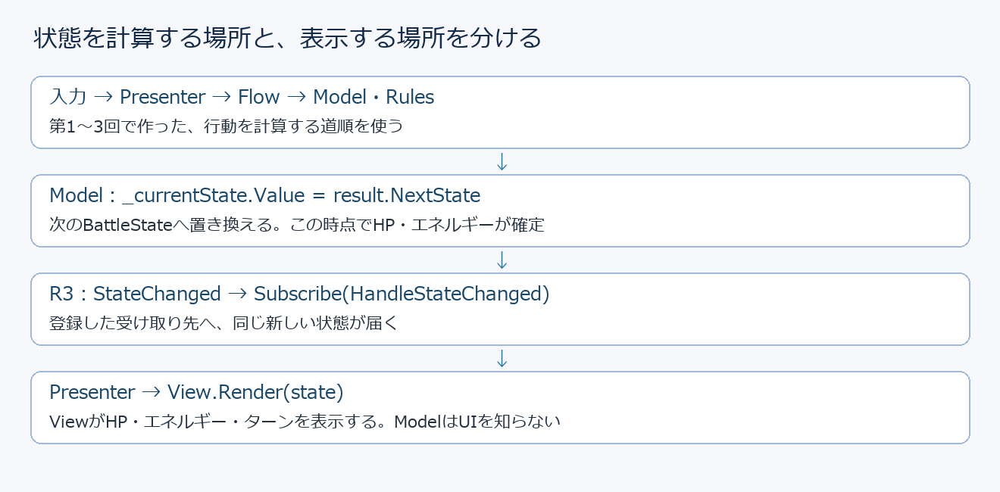
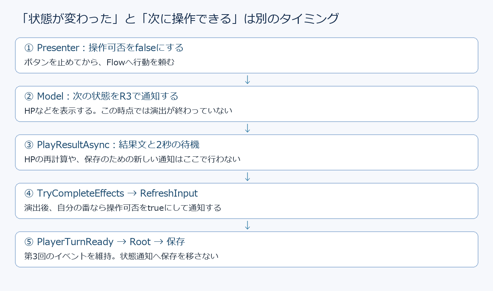
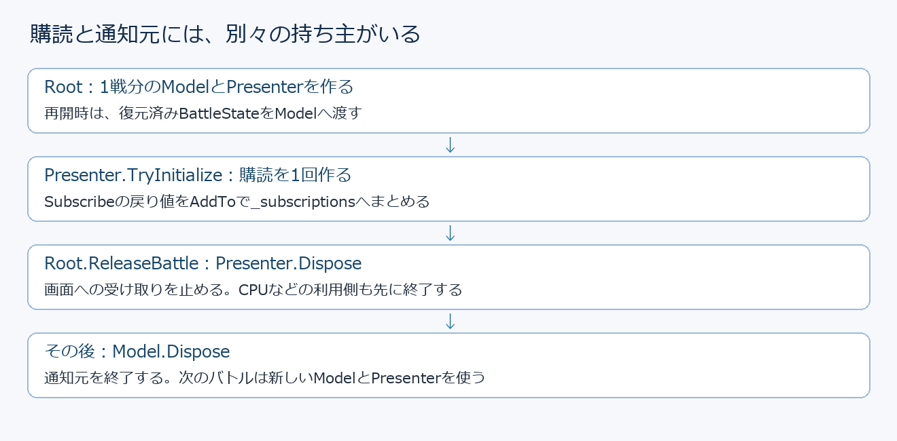
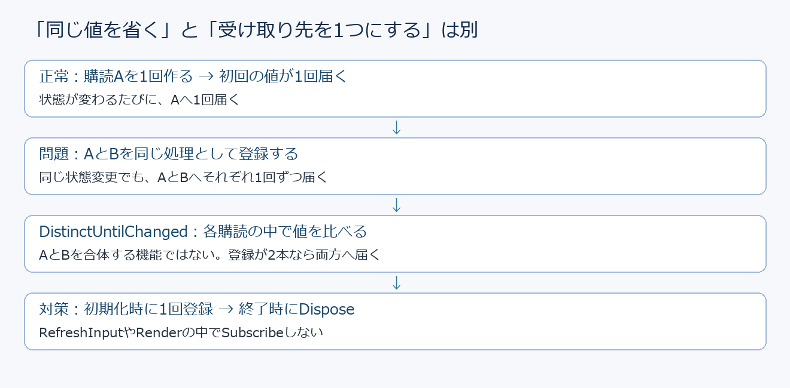

# 第4回：R3で状態の変化を画面へ届ける

## 今日の目標

HP・エネルギーが変わったときに画面へ知らせ、操作できるタイミングではボタンを使えるようにします。さらに、バトルが終わったら通知の受け取りを止め、再戦で前の表示処理が残らないようにします。

* イベント通知とR3の違いを、値を送る側・受け取る側・終了する場所から説明できる。
* 今の状態を通知し、HP・エネルギーを同じBattleStateから表示できる。
* HPが変わるタイミングと、次の操作ができるタイミングを分ける。
* 購読を1回だけ作り、持ち主が終わるときにDisposeする。
* 課題では相手のHP警告、警告ログ、双方のHP通知を実装する。

### 今日の進め方

* 1コマ目：イベントとの比較、R3の言葉、小さな実験、Modelの状態通知。
* 2コマ目：Presenterで受け取り、HP・エネルギー・操作可否を表示へ接続。
* 3コマ目：購読と通知元の終了、自分のHP警告の接続、重複通知の数え方。
* 4コマ目：課題3問。相手のHP警告とログを基本、双方のHP通知を発展とする。

### 差分の読み方

既存ファイルを編集するコードはdiff形式で示します。各ブロックの直前にファイル名を記載し、@@の行で変更する関数や場所を示します。

* -で始まる赤い行：今あるコードから削除する。
* +で始まる緑の行：その位置へ追加する。
* 先頭が空白の行：位置を探すために載せた、残すコード。
* @@の行：変更場所の案内。C#のコードとして書かない。

先頭の+や-は差分の印なので、C#ファイルには入力しません。「-と+の組」は行の置き換えです。+だけなら追加、-だけなら削除です。掲載していない既存の処理は残します。これは授業で変更場所を探すための抜粋で、git applyに渡すパッチではありません。コメントや空白の表記が少し違う場合は、関数名と処理の行を目印にします。

## はじめに：何が変わるのか

これまではPresenterが「今表示し直そう」と考えた場所でRenderを呼んでいました。今回はModelが「新しい状態になった」と知らせ、Presenterがそれを受け取ってRenderへ渡します。ModelにTextMeshProやボタンの参照を持たせる必要はありません。



HPだけを別の場所で書き換えたり、エネルギーを別の計算で更新したりはしません。これまでどおりRulesが新しいBattleStateを作り、その中にある両者のHP・エネルギー・防御・ターンをまとめて通知します。表示が同じ時点の値になるためです。

## 授業を始める前に

R3本体とUnity用のR3.Unityは別の導入手順です。using R3;を書くだけでは使えません。講師が導入を案内するので、全員同じバージョンにそろえます。

* NuGetForUnityを導入し、NuGetの管理画面からR3 1.3.1を入れる。依存パッケージも一緒に入る。
* Package ManagerのGit URLからR3.Unityを追加する。授業用の指定URLは下に記載。
* コンパイルが終わってから作業する。R3.Unityだけを入れてR3本体を省かない。
* 第3回の開始・再開・攻撃・回復が動くプロジェクトを使う。パッケージ以外の既存ファイルは授業中に編集する。

```text
NuGetForUnity（未導入の場合）
https://github.com/GlitchEnzo/NuGetForUnity.git?path=src/NuGetForUnity#v4.5.0

R3.Unity
https://github.com/Cysharp/R3.git?path=src/R3.Unity/Assets/R3.Unity#1.3.1
```

### NuGetForUnityがまだ入っていない場合

NuGetForUnityは、UnityのプロジェクトへNuGetのライブラリを入れるための道具です。この道具を入れただけでは、R3本体はまだ入りません。上部メニューにNuGetがある人は、この準備を飛ばして次へ進みます。

1. UnityのPlayモードを止め、Package Managerを開く。
2. 「＋」から「Add package from git URL...」を選ぶ。Unityの表示言語によっては「Git URLからパッケージを追加」の表記になる。
3. 上に記載したNuGetForUnityのURL（末尾が#v4.5.0のもの）を貼り付け、Addを押す。
4. ダウンロードとコンパイルが終わるまで待つ。Unityの上部メニューにNuGetが追加されたら、次の手順へ進む。

### R3コアモジュールをNuGetForUnity経由で導入する

ここで入れるパッケージ名はR3です。ReactivePropertyやSubscribeなど、今回C#から使う本体に当たります。R3.UnityはUnityとの連携用で、この後に別途追加します。Visual Studio側の「NuGetパッケージの管理」ではなく、Unity Editorのメニューから操作します。

1. Unityの上部メニューで「NuGet → Manage NuGet Packages」を開く。
2. 開いた画面のOnlineタブを選び、Search欄にR3と入力する。Show Prereleaseはオフにして、正式版だけを表示する。必要ならRefreshを押し、検索結果が出るまで待つ。
3. 検索結果から、パッケージ名がR3の項目を選ぶ。名前にR3が含まれている別の拡張パッケージを選ばない。
4. Installの近くにあるバージョンの一覧から、授業で使う1.3.1を選ぶ。新しいバージョンが表示されても、この授業では指定版にそろえる。
5. Installを押す。R3が必要とする依存パッケージも導入されるので、そのまま完了を待つ。途中でUnityを閉じたり、別のパッケージを続けて追加したりしない。
6. Installedタブを開き、R3と導入したバージョン1.3.1が表示されていることを見る。既にこの版が入っている人は、入れ直さない。違う版の場合は講師に伝える。
7. Unityのコンパイルが終わるまで待ち、Consoleに赤いエラーが出ていない状態にする。これでR3コアの導入が終わる。

### 続けてR3.Unityを入れる

1. Package Managerを開き、「＋」からGit URLで追加する項目を選ぶ。
2. 上に記載したR3.UnityのURL（末尾が#1.3.1のもの）を貼り付け、Addを押す。既に同じ版がある場合は追加しない。
3. 追加とコンパイルの完了を待つ。R3本体とR3.Unityの両方がそろってから、1コマ目のサンプルを作る。

導入後は、この資料のR3NotificationSampleを使います。using R3;やReactiveProperty<int>がエラーにならず、Play時にConsoleへ100、80が出れば、授業で使う基本的な通知を動かせています。

### メニューやパッケージが見つからないとき

* NuGetメニューがない：NuGetForUnityの追加とコンパイルが完了しているか、先に出ているConsoleの赤いエラーがないかを見る。R3の検索はPackage Managerではなく、NuGetの管理画面で行う。
* R3が検索結果に出ない：Onlineタブ、検索文字、インターネット接続を見てからRefreshする。検索先の設定を変更している場合は講師へ伝える。
* using R3;がエラーになる：R3.Unityだけでなく、NuGet側のInstalledにもR3があるかを見る。Unityがまだコンパイル中なら完了を待つ。
* 別PCで開いた後に依存パッケージがない：講師の配布方法を確認し、必要に応じてUnityの「NuGet → Restore Packages」で復元する。DLLを探して何重にもコピーしない。

## 1コマ目：イベントから「値を持つ通知」へ

### これまでのイベントと比べる

イベントでは、送る側がInvokeし、受け取る側が+=で関数を登録し、-=で解除します。例えばModelのActionResolvedは行動結果の通知、第3回のPlayerTurnReadyは演出後の保存タイミングの通知でした。

R3ではSubscribeで受け取り先を登録します。戻り値のIDisposableをDisposeすると、その受け取りを終了できます。ReactivePropertyは現在の値も持つので、登録した直後に今の値が届きます。

イベントもR3も、複数の相手へ知らせることができます。「イベントは1対1、R3は1対多」という違いではありません。R3ではSelectなどで必要な情報を取り出したり、終了する購読をまとめて管理したりしやすくなります。短い通知には、イベントのままの方が読みやすい場合もあります。

### 同じ状態を知らせるときの書き方

次は比較のための説明用コードです。今のファイルへ追加するコードではありません。nextStateはRulesが作った新しい状態、HandleStateChangedはそれを受け取る関数だと考えます。

```csharp
// イベント：送る側の宣言と通知。
public event UnityAction<BattleState> StateChanged;
StateChanged?.Invoke(nextState);

// イベント：受け取る側が登録し、終了時に解除。
model.StateChanged += HandleStateChanged;
model.StateChanged -= HandleStateChanged;
```

```csharp
// R3：送る側が値を更新すると、購読先へ届く。
_currentState.Value = nextState;

// R3：受け取りを登録し、戻り値で終了する。
var subscription = model.StateChanged.Subscribe(HandleStateChanged);
subscription.Dispose();
```

上のイベントのStateChangedという名前は、通知の役割を比べるために使っています。実際の移行コードはこの後のBattleModelにまとめています。イベントの宣言とR3の同名プロパティを同じクラスへ両方追加しないでください。

### 新しく出てくる言葉

* ReactiveProperty<T>：T型の現在値と変更通知を持つ入れ物。Valueで読み書きする。今回はModelの中だけで値を書き換える。
* ReadOnlyReactiveProperty<T>：現在値を読み、通知を受け取れる公開用の型。公開された入口からValueへ代入できない。BattleState内のinit専用プロパティを、自由に変更できるようにするものではない。
* Subscribe：通知の受け取り先を登録する関数。ReactivePropertyなら、登録中に現在値がすぐ届く。
* IDisposable：Disposeという終了用の関数を呼べることを表す型。ゲームオブジェクトを削除する意味ではない。
* CompositeDisposable：複数の購読をまとめる箱。箱のDisposeで、中の購読をまとめて終了できる。
* AddTo：Subscribeが返した購読を、終了を担当する箱へ入れるR3の拡張メソッド。
* Select：届いた値から、必要な値へ作り替える。リストの選択ボタンとは別の意味。
* DistinctUntilChanged：その購読へ届いた前回の値と同じなら、その先へ流さない。

### 小さな実験：初回と、同じ値の扱い

新しいMonoBehaviourのR3NotificationSample.csを、Assets/TurnForge/Scripts/Lessonsへ作ります。既存スクリプトには書きません。Mainシーンの空のGameObjectへ付け、PlayするとConsoleへ値が出ます。終了後はこのサンプルを無効にして、バトルのログと混ざらないようにします。

```csharp
using R3;
using UnityEngine;

/// <summary>現在値・重複・購読終了を短い順序で試す。</summary>
public sealed class R3NotificationSample : MonoBehaviour
{
    /// <summary>実験用のHP。バトルのHPとは別。</summary>
    private readonly ReactiveProperty<int> _hp = new ReactiveProperty<int>(100);

    /// <summary>実験を始め、受け取った値をConsoleへ出す。</summary>
    private void Start()
    {
        var subscription = _hp.Subscribe(hp => Debug.Log($"実験HP: {hp}"));
        _hp.Value = 80;
        _hp.Value = 80;
        subscription.Dispose();
        _hp.Value = 60;
    }

    /// <summary>実験の通知元を終了する。</summary>
    private void OnDestroy()
    {
        _hp.Dispose();
    }
}
```

Consoleに出る値は100、80です。最初の100は攻撃の通知ではなく、購読した直後の現在値です。2回目の80は同じ値なので通知されず、60は購読を終えた後なので届きません。

hp => Debug.Log(...)のhpは届いた値を受け取る変数です。=>の右側が、その値を受け取ったときの処理になります。subscriptionは受け取りを終了するための手掛かりで、HPの値そのものではありません。

### ライブコーディング：BattleModel

ファイル：Assets/TurnForge/Scripts/Battle/BattleModel.cs。次の①〜⑤の差分を上から順に反映します。使っていない第4回TODOや、その下に残ったreturn falseは削除します。Rulesの計算や、差分に載っていない既存の処理は残します。

* _currentStateをBattleStateからReactiveProperty<BattleState>へ変更する。
* CurrentStateはValueを返し、既存のFlow・CPU・保存処理がそのまま読めるようにする。
* StateChangedを追加し、Presenterが読む入口を作る。
* ActionResolvedの宣言とInvokeを削除する。プロジェクト内で購読していた場合は、その購読も削除する。今回の例では通知元を2系統に増やさない。
* TryExecuteの成功時だけValueへ結果を入れる。失敗した要求では通知しない。
* IDisposable・_isDisposed・Disposeを追加する。実際に呼ぶ場所は3コマ目に接続する。

#### ① ファイル先頭とクラス宣言

```diff
@@ ファイル先頭：usingを追加・削除 @@
+using System;
+using R3;
 using TF.Battle.Commands;
 using TF.Battle.Models;
 using TF.Battle.Rules;
-using UnityEngine.Events;

@@ BattleModelのクラス宣言 @@
-public sealed class BattleModel
+public sealed class BattleModel : IDisposable
```

#### ② フィールドとプロパティ

_rulesはそのまま残します。_currentStateの型、CurrentState、ActionResolvedの部分を変更します。

```diff
@@ BattleModel：クラス内のフィールド・プロパティ @@
-private BattleState _currentState;
+private readonly ReactiveProperty<BattleState> _currentState;
+
+/// <summary>このModelが終了したか。</summary>
+private bool _isDisposed;

-public BattleState CurrentState => _currentState;
+public BattleState CurrentState => _currentState.Value;

 /// <summary>
-/// 実行できる行動の結果を適用した後に通知
+/// 外から値を設定できない、状態の通知元。
 /// </summary>
-public event UnityAction<BattleResult> ActionResolved;
+public ReadOnlyReactiveProperty<BattleState> StateChanged => _currentState;
```

#### ③ コンストラクター

```diff
@@ BattleModel(BattleRules rules, BattleState initialState)の中 @@
 _rules = rules;
-_currentState = initialState;
+_currentState = new ReactiveProperty<BattleState>(initialState);
```

#### ④ CanExecuteとTryExecute

両方の関数にあるnullの判定を変更します。_currentStateが入れ物になるので、状態を読む場所はCurrentStateへそろえます。

```diff
@@ CanExecute(BattleSide actor, BattleCommand command) @@
-if (_rules == null || _currentState == null)
+if (_isDisposed || _rules == null || CurrentState == null)
 {
     return false;
 }

-var request = new BattleActionRequest(actor, _currentState.TurnNumber, command);
-return _rules.CanExecute(_currentState, request);
+var request = new BattleActionRequest(actor, CurrentState.TurnNumber, command);
+return _rules.CanExecute(CurrentState, request);

@@ TryExecute(BattleActionRequest request, out BattleResult result) @@
 result = null;
-if (_rules == null || _currentState == null)
+if (_isDisposed || _rules == null || CurrentState == null)
 {
     return false;
 }

-if (!_rules.TryExecute(_currentState, request, out result))
+if (!_rules.TryExecute(CurrentState, request, out result))
 {
     return false;
 }

-_currentState = result.NextState;
-ActionResolved?.Invoke(result);
+// Valueの置き換えで、状態の更新と通知を行う。
+_currentState.Value = result.NextState;
 return true;
```

#### ⑤ Disposeを追加する

TryExecuteの閉じる}の下、BattleModelクラスの最後の}より上へ追加します。既存の関数の中には入れません。

```diff
@@ BattleModel：TryExecuteの下へ追加 @@
+/// <summary>このModelの状態通知を終了する。</summary>
+public void Dispose()
+{
+    if (_isDisposed)
+    {
+        return;
+    }
+
+    _isDisposed = true;
+    _currentState.Dispose();
+}
```

### Modelの各入口がしていること

_rulesはこれまでの計算担当、initialStateは初期値または第3回で復元した状態です。コンストラクターはこの状態を入れ物へ入れます。これだけでは「保存したファイルから読む」処理を追加したことにはなりません。

StateChangedは入れ物を新しく作る関数ではありません。同じ_currentStateを読み取り用の型で返しています。呼ぶたびに別の通知元ができるわけではありません。

TryExecuteはrequestという行動の指示を受け、out resultへ結果を返す既存の入口です。成功後に_currentState.Valueへ代入すると、購読中の関数がその場で呼ばれます。これは次のUpdateまで待つ処理ではありません。

今回のBattleStateは値を書き換えず、新しいオブジェクトへ置き換えます。HPが同じでもターンが違う新しいBattleStateなら通知されます。ReactiveProperty<BattleState>が、内部のHPまで自動で見比べてくれるわけではありません。

## 2コマ目：HP・エネルギー・操作可否を表示へつなぐ

### Presenterが受け取りを担当する理由

Viewは文字やボタンを表示し、Modelは今の状態を持ちます。その間で「どの通知を、どの表示へ渡すか」を決めるのがPresenterです。今回もModelからBattleViewを直接呼びません。



HPとエネルギーは同じStateChangedで届き、既存のRenderが両者の現在値と最大値を表示します。操作できるかは、HPの変更だけでは決まりません。自分の番か、演出中か、戦闘終了かも含めてPresenterのCanAcceptPlayerInputで決めます。

### 追加するフィールド

ファイル：Assets/TurnForge/Scripts/UI/Battle/BattlePresenter.cs。先頭にusing R3;を追加し、クラス内の_lifeTimeCtsのすぐ下へ次の2つを追加します。関数の中には書きません。

```diff
@@ BattlePresenter.cs：ファイル先頭 @@
+using R3;

@@ BattlePresenter：_lifeTimeCtsのすぐ下 @@
 private readonly CancellationTokenSource _lifeTimeCts = new CancellationTokenSource();
+
+/// <summary>このPresenterが受け取るR3の購読をまとめる。</summary>
+private readonly CompositeDisposable _subscriptions = new CompositeDisposable();
+
+/// <summary>この画面から今操作できるかを通知する。</summary>
+private readonly ReactiveProperty<bool> _canAcceptInput = new ReactiveProperty<bool>(false);
```

_subscriptionsはこのPresenterが作った受け取りの一覧、_canAcceptInputは今この画面から操作できるかを持つ通知元です。falseは操作不可、trueは操作可能です。技ごとの使用条件は既存のSetCommandEnabledで扱い、操作全体のtrueだけで全ての技を使えるようにはしません。

### TryInitializeの表示部分を置き換える

同じファイルのTryInitializeで、既存のイベント3つの登録と_isInitialized = true;は残します。その直後のRender・SetSelectedCommand・RefreshInputの3行を、次へ置き換えます。return true;は残します。

```diff
@@ BattlePresenter.TryInitialize：_isInitialized = true;の直後 @@
 _isInitialized = true;

-_view.Render(_model.CurrentState);
+// 操作可否の現在値を受け取り、以後の変化を表示へ渡す。
+_canAcceptInput
+    .Subscribe(_view.SetInputEnabled)
+    .AddTo(_subscriptions);
+
+// 最初に現在の状態を受け取り、その後も変更を受け取る。
+_model.StateChanged
+    .Subscribe(HandleStateChanged)
+    .AddTo(_subscriptions);

 _view.SetSelectedCommand(_selectedCommand);
-RefreshInput();
 return true;
```

最初に操作可否を購読し、初期値falseをViewへ渡します。次に状態を購読すると、その場で現在のBattleStateがHandleStateChangedへ届きます。この関数が初回のRenderとRefreshInputを行うので、別の初回Renderを残さないようにします。

Subscribe(_view.SetInputEnabled)は「boolが届いたら、そのboolを引数としてSetInputEnabledを呼ぶ」という書き方です。Subscribe(enabled => _view.SetInputEnabled(enabled))と同じ役割です。AddToは通知の後に呼ばれる処理ではなく、返された購読を箱へ登録しています。

### HandleStateChangedを追加する

同じファイルで、TryInitializeの閉じる}の下、HandleCommandSelectedのコメントより上へ追加します。stateは通知で届いたBattleStateです。Renderは既存のHP・エネルギー・ターン表示、RefreshInputは既存の技の条件と選択の更新です。

```diff
@@ BattlePresenter：TryInitializeの下へ追加 @@
+/// <summary>HP・エネルギー・ターンを表示し、操作の条件を更新する。</summary>
+private void HandleStateChanged(BattleState state)
+{
+    if (_isDisposed || state == null)
+    {
+        return;
+    }
+
+    _view.Render(state);
+    RefreshInput();
+}
```

### 操作可否をR3から渡す

同じファイルのRefreshInputの最後にある_view.SetInputEnabled(canAcceptInput);を、次の1行へ置き換えます。途中の各技の条件判定、選択の解除、SetSelectedCommandは残します。

```diff
@@ BattlePresenter.RefreshInput：末尾の入力受付の更新 @@
 _view.SetSelectedCommand(_selectedCommand);
-_view.SetInputEnabled(canAcceptInput);
+_canAcceptInput.Value = canAcceptInput;
```

さらにTryExecuteAsyncの冒頭で、_isExecuting = true;の直後にある_view.SetInputEnabled(false);を、次へ置き換えます。

```diff
@@ BattlePresenter.TryExecuteAsync：実行開始時 @@
 _isExecuting = true;
-_view.SetInputEnabled(false);
+_canAcceptInput.Value = false;
```

これで操作可否を変更する入口はValueへの代入になります。同じfalseを繰り返し入れても、ReactiveProperty<bool>は同じ値を通知し直しません。CanAcceptPlayerInputの条件や、演出後のRefreshInput呼び出しは残してください。Flowの段階が変わるだけでこのboolが自動更新されるわけではないためです。

### HPを何か所からも表示しないようにする

次の2か所を編集します。これを省くと、購読が1本でも同じ状態を何度もRenderしてしまいます。

* BattlePresenter.TryExecuteAsync：演出待ちの後にある_view.Render(_model.CurrentState);の1行を削除する。TryCompleteEffects、RefreshInput、BattleFinished、PlayerTurnReadyは残す。
* BattleView.csのPlayResultAsync：ifの中にあるRender(result.NextState);の1行を削除する。SetText(_resultText, ...)、2秒待機、キャンセル通知は残す。

#### 削除①：BattlePresenter.csのTryExecuteAsync

```diff
@@ 演出待ちの後：このRenderだけ削除する @@
-_view.Render(_model.CurrentState);

 if (!_flow.TryCompleteEffects(result))
 {
     RefreshInput();
     return false;
 }

 RefreshInput();
```

#### 削除②：BattleView.csのPlayResultAsync

```diff
@@ PlayResultAsync：ifの中のRenderだけ削除する @@
 if (!token.IsCancellationRequested && result?.NextState != null)
 {
-    Render(result.NextState);
     SetText(_resultText, message ?? string.Empty);
 }
```

2秒待機のawait UniTask.Delay(...)は、この差分の下にある既存の行です。そのまま残します。

PlayResultAsyncは結果の文章と待機を担当します。状態の数値表示はModelからの通知で先に更新されています。攻撃後も2秒の待機がなくなるわけではありません。

### SelectとDistinctUntilChangedで必要な値だけ受け取る

HPだけを見る購読を作るなら、次の形になります。これは読み方を学ぶ例です。基本のRenderへ追加する必須の購読ではありません。実際のHPとエネルギーの表示は、上で接続したRenderが担当しています。

```csharp
_model.StateChanged
    .Select(state => state.FirstCombatant.Hp)
    .DistinctUntilChanged()
    .Subscribe(hp => UnityEngine.Debug.Log($"HP通知: {hp}"))
    .AddTo(_subscriptions);
```

エネルギーだけを見る場合は、Selectの右側をstate.FirstCombatant.Energyへ変えます。HPが同じでエネルギーだけ変わった状態では、HPの購読は止まり、エネルギーの購読だけ先へ進みます。Selectは元のBattleStateを変更しません。

第3回時点ではエネルギーを増減する技が未実装でも、復元したエネルギーの初回表示はできます。通知の練習のために、未習のチャージ技の実装を追加する必要はありません。

## 3コマ目：購読を終わらせ、自分のHP警告を完成させる

### 購読の持ち主と通知元の持ち主



Presenterが終わるときには、Presenterが受け取っていた購読を終えます。Modelが終わるときには、Modelの通知元を終えます。どちらもDisposeという名前ですが、終わらせる対象が違います。

今回のRootは1戦ごとにModelとPresenterを作り直します。画面の表示・非表示だけのたびに、同じPresenterへ購読を追加しないでください。TryInitializeの_isInitializedによる二重初期化の防止も残します。

### Presenter.Disposeへ追加する

ファイル：Assets/TurnForge/Scripts/UI/Battle/BattlePresenter.cs。既存のDisposeの中で、イベント3つの解除と_isInitialized = false;を行うifが閉じた直後、_lifeTimeCts?.Cancel();の上へ追加します。既存の処理は残します。

```diff
@@ BattlePresenter.Dispose：イベント解除のifの後、Cancelの前 @@
+// Viewへの受け取りを先に止めてから、通知元を終了する。
+_subscriptions.Dispose();
+_canAcceptInput.Dispose();
+
 _lifeTimeCts?.Cancel();
```

CompositeDisposableをDisposeした後に、同じPresenterを再初期化する進め方にはしません。既存の_isDisposedによる判定も残します。新しいバトルには新しいPresenterを作ります。

### RootでModel.Disposeを呼ぶ

ファイル：Assets/TurnForge/Scripts/Composition/GameCompositionRoot.cs。既存のReleaseBattleの最後で、PresenterをDisposeして参照をnullにする処理の後、_battleFlow = null;と_battleModel = null;の直前へ次を追加します。

```diff
@@ GameCompositionRoot.ReleaseBattle：末尾 @@
+// 利用側のPresenterやCPUを終了した後に、通知元を終了する。
+_battleModel?.Dispose();
 _battleFlow = null;
 _battleModel = null;
```

下の2つの代入は既存の行です。重複して追加しないでください。ReleaseBattleは再戦やゲーム終了時に、1戦分の処理を片付ける既存の関数です。先にModelを終了すると、まだ使っているCPUやPresenterが古い通知元を読む可能性があるので、利用する側から終了します。

### 第3回の保存との関係

StateChangedが届くのは計算が終わった直後です。PlayerTurnReadyが届くのは演出が終わり、次に自分が操作できる区切りです。同じ通知へまとめないでください。RootのHandlePlayerTurnReady、保存・ロード、勝敗後の保存は今回書き換えません。

R3の入れ物や購読をJSONへ保存する必要もありません。これまでどおりCurrentStateを読み、BattleSessionSaveDataへ必要な値を写します。再開時は復元したBattleStateからModelを作るので、購読直後の現在値として復元済みの値が表示されます。

### ライブコーディング：警告を表示する入口

まずライブコーディングで、既存の自分のHP・エネルギー欄を赤くします。BattleScreen.prefabにはBattleViewが付き、その_firstStatusには自分の状態を表示するTextMeshProUGUIが割り当てられています。ここを色の変更先にします。新しいTextやButtonを置く作業はありません。

ファイル：Assets/TurnForge/Scripts/UI/Battle/IBattleView.cs。インターフェースのRenderの宣言のすぐ下へ追加します。インターフェースなので、中身の{}は書きません。

```diff
@@ IBattleView.cs：Renderの宣言のすぐ下 @@
 void Render(BattleState state);
+
+/// <summary>自分のHPが少ないときの警告表示を切り替える。</summary>
+void SetLowHpWarning(bool isLowHp);
```

ファイル：Assets/TurnForge/Scripts/UI/Battle/BattleView.cs。_firstStatusの宣言のすぐ下へ追加します。ColorはUnityEngineの色を表す型です。

```diff
@@ BattleView.cs：_firstStatusの宣言のすぐ下 @@
 [SerializeField] private TextMeshProUGUI _firstStatus;
+
+/// <summary>警告していないときの、自分の状態欄の色。</summary>
+private Color _normalFirstStatusColor;
```

同じBattleViewで、OnEnableの上へAwakeを追加します。既にAwakeがある場合は新しく増やさず、その中へifの部分を追加します。AwakeはUnityがこのコンポーネントの初期化時に呼ぶ関数です。元の色を先に覚えることで、回復したときに元へ戻せます。

```diff
@@ BattleView.cs：既存のOnEnableより上へ追加 @@
+/// <summary>警告する前の文字色を覚える。</summary>
+private void Awake()
+{
+    if (_firstStatus != null)
+    {
+        _normalFirstStatusColor = _firstStatus.color;
+    }
+}
```

同じBattleViewで、Renderの閉じる}の下、SetInputEnabledのコメントの上へ追加します。isLowHpは警告するかどうかです。色を決めるだけでHPの数値やマスタを変更する関数ではありません。

```diff
@@ BattleView.cs：Renderの下、SetInputEnabledより上へ追加 @@
+/// <summary>自分のHPが少ないことを、既存のHP欄へ表示する。</summary>
+public void SetLowHpWarning(bool isLowHp)
+{
+    if (_firstStatus != null)
+    {
+        _firstStatus.color = isLowHp ? Color.red : _normalFirstStatusColor;
+    }
+}
```

### ライブコーディング：自分のHP警告を通知につなぐ

表示の入口だけで終わらせず、自分のHPが少ないと赤くなり、回復すると元の色へ戻るところまで一緒に作ります。相手側は課題1で作ります。

ファイル：Assets/TurnForge/Scripts/UI/Battle/BattlePresenter.cs。TryInitializeの通常表示用のStateChangedの購読のすぐ下、_view.SetSelectedCommand(_selectedCommand);の上へ追加します。初期化済みの判定より後なので、1つのPresenterに1回だけ登録します。

```diff
@@ BattlePresenter.TryInitialize：通常表示用の購読の下 @@
 _model.StateChanged
     .Subscribe(HandleStateChanged)
     .AddTo(_subscriptions);
+
+// 自分のHPから、警告するかどうかを取り出す。
+_model.StateChanged
+    .Select(state => state.FirstCombatant.Hp > 0
+        && (long)state.FirstCombatant.Hp * 4 <= state.FirstCombatant.MaxHp)
+    .DistinctUntilChanged()
+    .Subscribe(_view.SetLowHpWarning)
+    .AddTo(_subscriptions);

 _view.SetSelectedCommand(_selectedCommand);
```

* state => ...：届いたBattleStateをstateという名前で受け取り、右側の計算結果を返す短い関数です。
* FirstCombatant：このゲームでは自分。SecondCombatantは相手です。Hpは現在HP、MaxHpは最大HPです。
* Hp > 0 && ...：&&の左右を両方満たしたときだけtrueになります。HP0なら警告しません。
* Hp * 4 <= MaxHp：最大HPの4分の1以下かを、小数の割り算を使わずに調べます。最大HP100ならHP25でtrue、26でfalseです。
* (long)Hp：掛け算より先に、大きな整数を扱えるlongへ変換します。計算途中の桁あふれを避けます。
* Select：状態全体から「警告するか」というboolを作ります。HPそのものは変更しません。
* DistinctUntilChanged：直前に渡したboolと同じなら省きます。HP25→20では両方trueなので、警告表示は呼び直しません。数値は通常のRenderで更新されます。
* Subscribe(_view.SetLowHpWarning)：trueもfalseも表示へ渡します。trueだけを渡すと、回復後に赤が残ります。
* AddTo(_subscriptions)：この受け取りをPresenter.Disposeで終える一覧へ登録します。

ViewのisLowHp ? Color.red : _normalFirstStatusColorは「trueなら赤、falseなら覚えておいた元の色」という意味です。Awakeで元の色を覚え、ここでは元の色を上書きしません。

購読した直後には現在値も届きます。新規開始・再戦では新しいHPに合う色へ戻り、第3回の続きから始めた場合は復元済みHPに合う色になります。再開専用の色設定や、警告を保存する項目は追加しません。

### ライブコーディング：受け取った値をログにも出す

同じTryInitializeに今追加した自分の警告のSubscribeだけを置き換えます。購読をもう1本作る変更ではありません。

```diff
@@ TryInitialize：自分の警告用のSubscribeだけ変更 @@
     .DistinctUntilChanged()
-    .Subscribe(_view.SetLowHpWarning)
+    .Subscribe(isLowHp =>
+    {
+        UnityEngine.Debug.Log($"自分のHP警告: {isLowHp}");
+        _view.SetLowHpWarning(isLowHp);
+    })
     .AddTo(_subscriptions);
```

isLowHp => { ... }は、届いたboolを使って複数行の処理をする書き方です。ログを出した後に、同じ値をViewへ渡します。$"..."の{isLowHp}には、受け取った値が入ります。ログはDistinctUntilChangedの後なので、初回と警告が切り替わったときだけ出ます。

最大HP100でHP100→25→20→26と進む場合、警告のログはFalse→True→Falseの3回です。HP20は警告が変わらないため省かれます。通常の状態通知と警告のログは、数える対象が違います。

### 重複通知を数える場所

BattlePresenter.HandleStateChangedのreturn判定の下、_view.Render(state);のすぐ上へ、一時的に次の行を追加します。

```diff
@@ BattlePresenter.HandleStateChanged：Renderのすぐ上へ一時追加 @@
+UnityEngine.Debug.Log($"状態通知: ターン{state.TurnNumber}");
 _view.Render(state);
 RefreshInput();
```

このログを、警告用のSubscribeの数と混同しないでください。StateChangedから数値表示へ届く回数を数えています。初回の現在値が1回、その後は成功した行動の新しい状態ごとに1回です。プレイヤーの攻撃とCPUの攻撃は別の行動なので、それぞれ1回です。1往復で2回出ること自体は重複ではありません。

警告の通知を数える場合は、そのSubscribeの中へ別の名前のログを入れます。初回true／falseの通知と、値が変わった後の通知を分けて数えます。



### 3コマ目の補足：よく使うR3の関数と組み合わせ

ここは今日の復習と、今後使える書き方の紹介です。参考の関数をすべて実装する必要はありません。今のゲームは、ここまでに書いた通知と終了処理で動きます。

#### 今日使った関数を整理する

* Subscribe：値が届いたときに何をするかを登録する。例はSubscribe(HandleStateChanged)。戻り値は、その受け取りを終了するためのIDisposableで、HPの値ではない。ReactivePropertyでは登録したその場で現在値も届く。
* Select：届いた値から必要な情報を取り出す、または別の値へ変換する。例はBattleStateからHP、警告のbool、双方のHPの文字列を作る処理。元のBattleStateを書き換える関数ではない。
* DistinctUntilChanged：直前に渡した値と同じなら、先へ渡さない。HPを取り出してから置くとHPの変化、警告boolの後に置くと警告の切り替わりを見られる。別々のSubscribeを1本へまとめる働きはない。
* AddTo：Subscribeなどで得たIDisposableを、終了処理をまとめる相手へ登録する。今回のAddTo(_subscriptions)は「このPresenterが終わるときに止める一覧へ追加する」という意味。通知が来るたびに呼ばれる処理ではない。
* Dispose：そのIDisposableが持つ処理を終える。購読のDisposeは自分の受け取りを止め、ReactivePropertyのDisposeは通知元を終える。_subscriptions.Dispose()で登録した受け取りをまとめて終了する。

ReactiveProperty・ReadOnlyReactiveProperty・CompositeDisposableは関数名ではなく型の名前です。ReactivePropertyは現在値と変更通知、ReadOnlyReactivePropertyは外からValueを設定させない入口、CompositeDisposableはまとめて終了する対象を持ちます。

ラムダの中身を関数へ出しても意味は同じです。.Select(IsLowHp)は届いたBattleStateをIsLowHpへ渡し、その戻り値を次へ流します。.Subscribe(SetLowHpWarning)は届いたboolをSetLowHpWarningへ渡します。関数を作っただけでは登録されないので、SelectやSubscribeとの接続は残します。

#### 次によく使う関数：必要になったら調べる

* Where：条件を満たす値だけを先へ渡す。例は、移動方向が一定以上の入力だけを使う場合。Where(isLowHp => isLowHp)ではfalseが届かなくなるので、今回の「回復で通常色へ戻す」警告にはそのまま使わない。
* Merge：同じ型にそろえた複数の通知を、1つの受け取り先へ集める。例は、別々の入口から来る「決定」の通知。ただし、同じ押下が2経路から届いた場合も2回流れる。二重入力を自動で消す関数ではない。
* CombineLatest：複数の通知元がそれぞれ1回以上値を出した後、どれかが変わるたびに最新値の組み合わせを使う。例は「自分の番」と「演出中ではない」を組み合わせた操作条件。今回の双方のHPは1つのBattleStateにそろって届くので、課題3はSelectで十分。
* Observable.FromEvent：既存のC#イベントをR3の通知として扱う入口を作る。登録と解除を対で渡す。InputActionのイベントをつなぐときにも使えるが、受け取った値の種類とイベントの寿命を合わせる必要がある。

R3の関数の役割・一覧：公式README（授業で使う1.3.1）。
https://github.com/Cysharp/R3/blob/1.3.1/README.md

#### InputAction × R3：入力を受け取ってから使い方を整理する

相性のよい組み合わせです。InputActionは、キー・パッドなどの操作をMove・Submitのような目的へまとめます。R3はその通知を受け取り、Selectで値を取り出す、Whereで条件を付ける、Mergeで入口をそろえる、といった処理を読みやすく書けます。これは使いどころの提案で、今回の入力処理を書き直す指示ではありません。

* 方向入力の例：InputActionのperformed／canceled → そのコールバック中にReadValue<Vector2>()で値を取り出す → 方向の通知 → 必要な条件や表示へつなぐ。離したときのゼロ入力も必要ならcanceledを扱う。
* 決定入力の例：InputActionから来る決定とUIから来る決定を同じ意味の通知へそろえ、共通の処理へ渡す。ただし既存のInputSystemUIInputModuleがその入力をUIへ送っているなら、同じInputActionを別ルートでも処理して二重に決定しない。
* 操作条件の例：入力の通知と、今操作できるかという状態を分ける。決定直前には既存のCanAcceptPlayerInputや技の条件も確認する。R3へつなぐだけで演出中の入力が止まるわけではない。
* 寿命の例：イベントの登録・解除とR3の購読終了をそろえる。InputActionのEnable／Disableは入力そのものの受付、購読のDisposeは受け取りの終了で、同じ操作ではない。共有するActionを勝手にDisableしない。
* 値の例：CallbackContext自体を保存して後から読まず、コールバック中に必要なVector2やfloatを取り出す。押した回数を毎回使う決定操作と、同じ値を省きたい移動方向では、DistinctUntilChangedの使い方も変わる。決定を毎回trueとして同じ値を省くと、2回目以降を落としてしまう。

Unity Input System：Actionsの役割とEnable／Disable。
https://docs.unity3d.com/Packages/com.unity.inputsystem@1.11/manual/Actions.html

InputAction.CallbackContextとReadValueの説明。
https://docs.unity3d.com/Packages/com.unity.inputsystem@1.11/api/UnityEngine.InputSystem.InputAction.CallbackContext.html

#### ほかの組み合わせと、今回のゲームでの使いどころ

* Unity UI × R3：HP・警告・操作可否の変化をPresenterから表示へ渡す。今回すでに使っている組み合わせ。Viewの見せ方とRulesの計算を分けたまま扱える。
* UniTask × R3：繰り返し届く状態の通知はR3、1回の演出やロードの完了待ちはUniTaskに任せる。今回も状態表示はR3、PlayResultAsyncの2秒待機はUniTask。Subscribeの中で非同期処理を始めただけでは、次の通知や入力を待たせる仕組みにはならない。
* VContainer × R3：VContainerでModel・Presenterなどに必要な相手と寿命を組み立て、R3でその間の通知を扱う。DIは「誰を渡すか」、R3は「変わったことをどう知らせるか」。導入だけでイベント解除や購読終了がすべて自動になるわけではない。第4回では既存Rootの終了順を維持する。

UniTask公式資料：非同期処理とキャンセルの説明。
https://github.com/Cysharp/UniTask

VContainer公式資料：依存する相手の受け渡しとスコープの説明。
https://vcontainer.hadashikick.jp/


## 4コマ目：課題

### 課題1：相手のHPにも警告を追加する（基本）

* IBattleView.csのSetLowHpWarningの宣言の下へ、相手用のSetOpponentLowHpWarning(bool isLowHp)を宣言する。
* BattleView.csの_secondStatusの下へ、元の色を覚える_normalSecondStatusColorを追加する。
* 既存のAwakeで、_secondStatusがnullでないときに元の色を覚える。Awake自体は増やさない。
* BattleViewのSetLowHpWarningの下へSetOpponentLowHpWarningを実装し、trueなら相手の状態欄を赤、falseなら元の色にする。
* BattlePresenter.TryInitializeの自分の警告用購読の下へ、SecondCombatantの現在HP・最大HPを使う警告用の購読を1本追加する。
* 相手にも「HPが0より大きく最大HPの4分の1以下」の条件を使い、DistinctUntilChanged、Subscribe、AddToでつなぐ。

ヒント：BattleScreen.prefabのBattleViewでは_firstStatusが自分、_secondStatusが相手のHP・エネルギー表示です。既存の欄のcolorを変えます。新しいTextや参照欄を増やす必要はありません。自分用の変数や関数を相手側から使うと、自分の色を書き換えてしまいます。SecondCombatantから取り出したboolを、相手用の関数へ渡してください。相手の回復行動を新しく作る必要はありません。

### 課題2：相手の警告が切り替わったときにログを出す（基本）

* 課題1の相手用Subscribeを、ライブで書いたisLowHp => { ... }の形へ書き換える。
* その中に「相手のHP警告: True／False」が分かるDebug.Logを追加し、SetOpponentLowHpWarningの呼び出しも残す。
* ログを出すための新しいSubscribeは作らず、DistinctUntilChangedの後の既存の受け取りに追加する。
* 自分と相手のログの名前を分け、どちらの警告が変わったか読めるコードにする。

ヒント：ログは画面更新と同じboolを使います。相手のHPが25→20（最大100）になったときは、HP表示は変わっても警告のログは増えません。初回のFalseや再戦直後の1回は正常です。通常の状態通知が自分の行動・相手の行動で別々に出ることとも分けて考えます。

### 課題3：双方のHPをまとめて通知する（発展）

* BattlePresenter.TryInitializeの相手の警告用購読の下へ、双方のHP用の購読を1本追加する。
* SelectでFirstCombatant.HpとSecondCombatant.Hpを1つの文字列にまとめ、「自分HP: 値 / 相手HP: 値」の形にする。
* その後にDistinctUntilChangedを置き、双方のHPがどちらも同じならログを増やさないようにする。
* Subscribeでその文字列をDebug.Logへ渡し、AddTo(_subscriptions)へ登録する。
* 攻撃や回復でどちらかのHPが変わったときにログを出し、購読開始時にも双方の現在HPを1回出す。

ヒント：Selectはboolやintだけでなく文字列も返せます。ライブで使った$"..."の中に、{state.FirstCombatant.Hp}と{state.SecondCombatant.Hp}を両方入れます。文字列が同じかどうかをDistinctUntilChangedに比べさせます。ターン番号や行動する側は文字列へ入れません。最大HPで回復を選ぶと、その行動では双方のHPが変わらず、状態通知だけが届く場面を作れます。その後のCPU攻撃でHPが減った場合のログとは分けて見ます。新しい技や保存ファイルの手編集は不要です。

## まとめ

* 状態を作るのはRules、採用して通知するのはModel、受け取って表示へ渡すのはPresenter。
* HP・エネルギーの表示と、演出後の操作可否は別のタイミング。
* ReactivePropertyは初回の現在値も届ける。同じ値を省くことと、購読が二重でないことは別。
* 購読はPresenterが終え、Modelの通知元はRootが利用側の終了後に終える。
* 保存は第3回の演出後の区切りを使い、R3の入れ物をJSONへ保存しない。

## 参考

* [R3 1.3.1公式README：ReactiveProperty・購読管理・Unityへの導入](https://github.com/Cysharp/R3/blob/1.3.1/README.md)
* [NuGetForUnity：導入とパッケージの復元](https://github.com/GlitchEnzo/NuGetForUnity)


